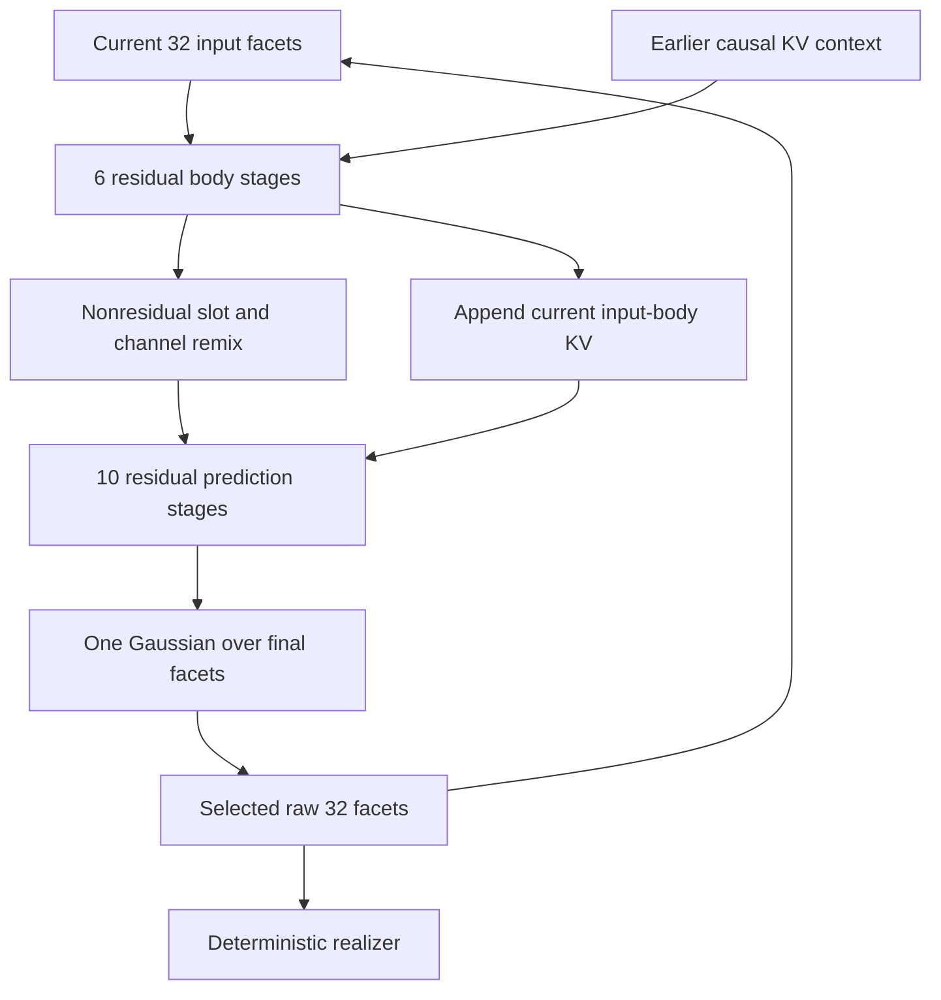

# Recurrent32: raw facets are the next input

Architecture version **3** uses **32 facets of width 512** and a maximum output
of **1,024 reference-codec positions**. The network finishes a prediction in that
32-facet space. Those final facets feed both the deterministic realizer and the
next core iteration directly. `compact32` retains 32 facets and the output limit
at width 256. The CPU profile uses four 32-wide facets and 128 output positions.
Profiles are explicit geometries; old recurrent-memory checkpoints are rejected.

The recurrent representation is the raw facet block. One explicitly bounded,
causal KV cache supplies earlier processed input context. There are no GDN state
matrices, private carry vector, A/B history branches, literal neural cache, extra
learned ingestion writer, or reconciliation with decoded bytes. Exact byte and
copy catalogs remain explicit public data available to the deterministic decoder.

## The core computation

Every prediction follows the same sequence:

The remix is an **internal boundary**, not the final prediction. It applies a
normalized channel SwiGLU followed by a learned facet-slot transform, with no
identity addition across that boundary. Ten subsequent residual attention and
pair-expert stages build the completed prediction. There is no second normalized
representation or output head that has to be reconciled before the next input.
Internal pre-normalization and gated residual updates stabilize the computation.

The body and prediction stages share the same packed P expert bank and the same
attention owners. Each stage has its own dense SwiGLU branch. Each stage performs
two sequential pair updates; the second reads the first update's result. Fixed
pair schedules and deterministic incident-facet reductions avoid unordered CUDA
atomics. A P route is compiled at the body entrance and again at the remix boundary,
using causal epoch input plus fixed stage/row descriptors. Evolving pair values
and unrelated batch membership do not change those assignments.

The body always uses full pair coverage. Prediction effort 1/2/3/6 selects its
configured number of pair rows. Explicit control and effort enter once for the
current computation. A pending raw facet block already includes the conditioning
that produced it; there is no saved control vector to inject again as a second
state update. An observation-only transition consumes that pending input with
neutral control and full body effort. Replays preserve both the operation order
and the control supplied to each prediction call.

### One causal control protocol

Training, evaluation, serving, student collection, and tape replay share
`controls.build_control_payload` and `controls.encode_controls`. Seed bytes remain
unchanged. Nonempty reference bytes follow `\n<reference>\n`; nonempty public tool
lists follow `\n<tools>\n`. Only tool JSON is canonicalized: object keys are sorted,
whitespace is removed, Unicode stays UTF-8, and tool-list order is preserved.
Duplicate JSON keys and nonfinite numbers are rejected. A reference requires an
explicit origin of `external_evidence` or `earlier_history`; current/future targets
and verifier outcomes are not reference sources.

An absent control is the neutral zero, including an empty row batched alongside
nonempty controls. An all-empty batch skips the control encoder. Later training
phases detach shared frontend features while keeping the control encoder itself
trainable. Neither reference bytes nor tool descriptions create observations or
additional history entries.

The policy accepts raw `control_payload` bytes and stores them in every v3 action
tape. Scoring and native replay encode the tape-owned bytes under the replayed
weights; a different explicit scoring override is rejected. No caller must retain
an unversioned neural control vector. Served manifests name this tape protocol.
The Python serving API takes `control_seed`, `control_reference`,
`reference_origin`, and `tools_json`. JSONL accepts the first two as UTF-8 text;
its `tools` list, or alternative `tools_json` string, feeds both the public decoder
schema and the causal prior. The numeric JSONL `seed` only selects the Gaussian
random draw and remains separate from textual `control_seed`.

## State and observation chronology

The state invariant is precise:

- `CoreState.facets` is the **current unprocessed input**.
- `CoreState.history` contains the body KV of **earlier processed inputs**.
- Record counters count processed real inputs; a pending input is not counted yet.

`process(state)` consumes the pending input once, appends its body context, runs
the remix and prediction stages, and returns a new state whose facets are the
completed next-input prediction. A sampler replaces that mean with its one raw
sample through `replace_facets`; this method only replaces the tensor and optional
role metadata. It calls no neural module and preserves the processed history.

Observation requires care. A generated action's facets are still the pending
input when a tool response arrives. Replacing them immediately with the tool
response's encoding would discard the action from context. Therefore
`observe(bytes, state)` first runs the **same six-stage body helper** on a real
pending input, captures its context, and then installs `E(bytes)` as the new input.
It does no remix, prediction, or lexical work. The initial sentinel skips this
prior-input consumption. Consecutive system/user observations follow the same
rule. There is no independent learned observation writer.

The core's public methods expose those boundaries:

| Operation | Contract |
| --- | --- |
| `initial_state(batch_size, ...)` | Empty KV history and a learned initial sentinel; no real input has been processed. |
| `encode_chunk(byte_ids, lengths=None)` | Independent hierarchical `E(bytes)`, returning `[B,F,D]`. |
| `observe(byte_ids, state, ..., encoder_grad=True)` | Consume a pending prior input through the shared body, then install the observed encoding. |
| `consume_input(state, control=None, effort=6)` | Pure call-local six-stage body result, updated KV context, and processed-input counters. Shared by observation and prediction. |
| `process(state, control=None, effort=6, next_role_ids=None)` | Six-stage body, nonresidual remix, ten residual prediction stages; returns a new `CoreState` with raw final facets. |
| `replace_facets(state, raw_facets, role_ids=None)` | Verbatim pending-input replacement; no encoding, projection, or neural write. |
| `advance_raw(state, raw_facets, control=None, effort=6, role_ids=None)` | Fixed-tape replay: the same input body and pure raw replacement, skipping an already-known prediction. |
| `predict_facets(state, ...)` | Read-only inspection convenience that returns `process(...).facets` and discards its new context. Continuing trajectories use `process`. |
| `encode_control(..., encoder_grad=True)` | Causal control encoder; optional detachment of shared byte features leaves the control encoder trainable. |
| `prepare_realization(raw_facets)` | Decoder metadata containing exactly the original raw tensor. |
| `apply_u(rows, context, level)` | Shared output transform; no core state, historical feature, or control argument. |

The input state is immutable. A version check rejects state computed under older
model or routing weights. After an optimizer update, rebuild observed history from
its byte records and generated history from the **raw facet tape**, in the original
operation order. A many-to-one deterministic decoder generally cannot recover an
arbitrary selected facet tensor from its decoded bytes. `state.detach()` explicitly
cuts both the raw recurrence and KV history at a documented TBPTT boundary.

Every selected draw becomes the pending next input, including one whose decoded
bytes are invalid. Validation controls external execution. An actual environment
error becomes a subsequent observation. `decode_mean` and `decode_facets` are pure
inspection and do not advance the caller's state.

## Hierarchical byte/ngram ingestion

`E` begins with ordered native bytes and exact/hashed n-grams. The native table has
2,500,000 rows of width 16: exactly 40,000,000 parameters. Unigrams and, in the
production profiles, bigrams have exact addresses; longer hashed lookups are a
labelled fallback. Ordered byte features remain a separate path, preserving case,
zero bytes, byte order, and exact input boundaries.

The stride-eight frontend produces source features. A shared ordered pair merge
halves their positions at each level. Bounded local attention and a shared FFN
refine the merged features. Only the final at-most-32 source positions enter facet
query attention; there is no quadratic attention over the full byte sequence.
An aligned projection preserves ordered positions while query attention fills the
canonical facet block. Each batch row uses the first level at which it is ready,
so padding and a longer unrelated row cannot change its representation.

The encoder's final linear projection has no compulsory output normalization. It
can match the raw recurrent coordinate scale. Role, history, controls, and current
prediction targets do not enter this content encoder. The role and temporal input
position enter the shared core body separately. The encoder's native table remains
at `core.frontend.ngrams`; offline import, exact rounding-aware bake, optimizer
moment reset, and served parameter ownership use that same owner.

## Training the representation in two modes

The causal final prediction is computed before exposing the next target's bytes.
Alignment always concerns the **completed prediction**, after the ten residual
prediction stages. It does not supervise the internal remix seed.

During **bootstrap**, the full-coordinate Gaussian learns the detached target
`E(next_bytes)`. The decoder learns both reconstruction from `E(next_bytes)` and
realization from a causal prior sample. The next training input is the actual
encoded target: explicit early teacher forcing. Because it replaces the predicted
facet input, the causal KV cache is essential for retaining previous context.
Reconstruction supplies a content constraint; a freely learned regression target
alone would permit an uninformative encoding.

During **recurrent training**, the selected prior sample is the next live input.
Its computation graph continues through subsequent iterations, building a
recurrent prediction tower. The encoder follows the completed recurrent prediction:

`encoder_alignment = || E(next_bytes) - stop_gradient(final_mean) ||²`

This alignment updates **only E**. It cannot pull the core representation toward
the encoder. There is no bootstrap reconstruction or encoder-target prior-fit
loss in this mode. Main lexical/structural learning still trains the recurrent
core and decoder through the live trajectory. Observation and control frontend
paths use `encoder_grad=False` in these later phases, preventing those downstream
losses from secretly updating E. Control-encoder weights remain trainable.

The encoder is content-only, while recurrent predictions are context-dependent.
Their alignment is a training objective, not an assertion that every occurrence
of identical bytes under different contexts has an identical predicted tensor.
Measure alignment error, reconstruction, served-prior lexical loss, and task
quality together. These modes and their gradients are implemented; a useful
trained representation still requires training evidence.

Only one stochastic policy event remains: a diagonal Gaussian over all final
`F × D` coordinates. Its mean is the exact final core prediction. Length, structure,
bindings, lexical argmax, and byte materialization are deterministic given that
sample and the public schema/copy context. Latent-only outcome RL freezes E and
the complete deterministic decoder, including core-owned U weights, so replay
uses a fixed action map. `encoder_parameters()` and `realizer_parameters()` expose
those owners without registration aliases or fragile name matching.

## Widths, shared attention, and context cost

| Geometry | `recurrent32` | `compact32` |
| --- | ---: | ---: |
| Raw facets | `32 × 512` | `32 × 256` |
| Coordinates per prediction | 16,384 | 8,192 |
| Source width | 256 | 128 |
| Attention queries | `4 × 128 = 512` | `4 × 64 = 256` |
| Keys, separately values | `2 × 128 = 256` | `2 × 64 = 128` |
| Concatenated P row width | 1,024 | 512 |
| P experts / hidden width | `64 / 1536` | `64 / 1536` |
| Stage-private P dense hidden width | 1,024 | 1,024 |
| Remix hidden width | 1,024 | 1,024 |
| U experts / hidden width | `32 / 1024` | `32 / 1024` |
| Shared U dense hidden width | 512 | 512 |
| Historical KV slots per processed input | 32 | 32 |
| Maximum cached input chunks | 1,024 | 1,024 |
| Maximum BF16 KV storage per episode | 32 MiB | 16 MiB |
| One raw FP32 sampled facet block | 64 KiB | 32 KiB |
| Maximum output positions | 1,024 | 1,024 |

Each KV head serves two query heads. A single core query/KV/output projector set
is shared across all stages and both current-facet and historical-context reads.
The cache contains the six-stage body result of actual processed inputs. The
future final prediction is not inserted prematurely. Both production profiles
retain all 32 facet slots; `history_slots < n_facets` is an explicit compressed
ablation, not the default.

Unpadded history/current attention passes `attn_mask=None` to preserve fused SDPA
eligibility. Partial resets and padded/empty source batches retain real masks.
The hardware gate forces Flash attention and compares it with the math backend
at both production widths, including long projected histories. See the
[PyTorch SDPA API](https://docs.pytorch.org/docs/2.10/generated/torch.nn.functional.scaled_dot_product_attention.html)
for GQA constraints, backend selection, and floating-point differences.

For primary, one processed chunk's K and V require
`2 × 2 heads × 128 × 32 slots × 2 BF16 bytes = 32,768 bytes`. The 1,024-chunk bound
is therefore 33,554,432 bytes. This excludes raw facets, masks, activations,
autograd graphs, temporary concatenations, and the optimizer. Cache capacity is
explicit; it does not make long-history attention constant cost.

## Actual parameter and arithmetic accounting

These counts come from current instantiated core owners. They include E, the
remix, shared attention, and core-owned output banks, but exclude generator-owned
vocabulary/structural/realizer modules. Run `megatoken inspect` for the full served
ledger. No parameters are added to meet a target count.

| Core allocation | `recurrent32` | `compact32` |
| --- | ---: | ---: |
| Packed P bank | 301,989,888 | 150,994,944 |
| Packed U bank | 50,331,648 | 25,165,824 |
| Sixteen P wrappers, including norms/gates | 50,348,064 | 25,174,048 |
| Shared U dense branch | 786,432 | 393,216 |
| Hierarchical byte/ngram encoder | 44,056,622 | 41,029,934 |
| Nonresidual remix | 1,574,400 | 787,712 |
| Shared current/history attention | 787,456 | 197,120 |
| Entire core | **450,131,794** | **243,885,778** |

The tiny core has 249,870 parameters. The three-matrix SwiGLU count is `3 E d h`.
Thus the primary P bank is `3 × 64 × 1024 × 1536`; U is
`3 × 32 × 512 × 1024`. Doubling facet width while halving the earlier expert counts
preserves those two packed-bank totals. The total model count changes because
other modules and stage-private dense branches have their own geometry.

Counting multiplication and addition as two FLOPs, one active P row costs
`6 × (2D) × (1536 + 1024)` matrix FLOPs: 15,728,640 primary or 7,864,320 compact.

| Effort | Rows per prediction stage | Rows over ten prediction stages |
| --- | ---: | ---: |
| 1 | 16 | 160 |
| 2 | 32 | 320 |
| 3 | 48 | 480 |
| 6 | 96 | 960 |

The body always uses 576 pair rows. A complete full-effort iteration therefore
executes **24.15919104 GFLOPs of P matrix products** in primary, or
**12.07959552 GFLOPs** in compact. At the same hidden widths the former `128 × 256`
geometry used 48.31838208 GFLOPs for this particular work. These arithmetic ratios
exclude attention, encoding, routing, padding, memory movement, nonlinearities,
backward, and the decoder; they are not end-to-end speed measurements.

Historical attention is material at the maximum context. For `Q` facet queries,
`T` historical slots, and combined query width `A`, QK and attention-value products
cost `4 Q T A` FLOPs per stage. With 32 queries and primary `A=512`:

| Cached chunks | Historical slots | BF16 KV storage | Historical QK/AV FLOPs over 16 stages |
| --- | ---: | ---: | ---: |
| 16 | 512 | 0.5 MiB | 0.537 GFLOPs |
| 128 | 4,096 | 4 MiB | 4.295 GFLOPs |
| 1,024 | 32,768 | 32 MiB | 34.360 GFLOPs |

This table excludes current-facet attention and projection costs. Compact halves
both memory and this arithmetic. At maximum history, attention arithmetic exceeds
the scoped P-matrix count. The implementation also concatenates live/projected
history features during attention; that memory traffic must be profiled on actual
hardware. A smaller context limit is an explicit capacity/latency tradeoff.

An active U row costs `6D(1024 + 512)` matrix FLOPs: 4,718,592 primary or 2,359,296
compact. Its final shared dense refinement costs `6D × 512` per row. Decoder growth,
length, effort, and batch composition determine actual rows and grouped-kernel
padding. Measure the complete workload, not an isolated favorable matrix shape.

## Validation boundaries

CPU gates check the internal nonresidual boundary, exact raw tensor replacement,
observation chronology, no premature future KV, earlier-input gradients,
checkpointed history gradients, encoder-only later alignment paths, deterministic
routing, numerical replay, BF16 finite gradients, bounded state/reset/versioning,
actual parameter ownership, and engram bake parity. CUDA gates add grouped expert
forward/backward at production widths, Flash GQA including long history, and
complete same-weight raw-facet tape replay. Raw taped facets remain exact; derived
floating-point states and densities use tight backend-appropriate tolerances.

GPU compatibility, throughput, memory fit, and trained quality need their own
hardware/training evidence. See [the Blackwell runbook](blackwell.md).
