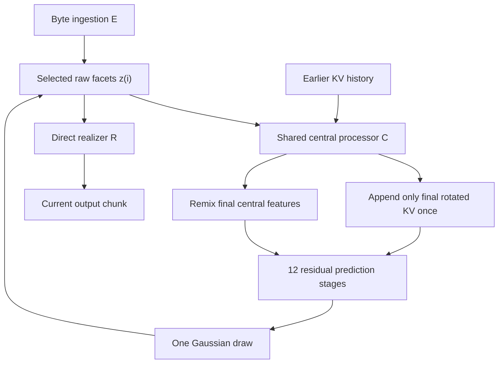

# Architecture v11: shared expert pools and multi-track causal KV

**The single-event path below is one special case of the multi-track core (architecture v11).**
Multiple tracks are integrated as one atomic meridian with a shared full-resolution
KV history and joint central processing. For the grouped contract, see the
[multi-track plan](multi-track-plan.md) and
[implementation status](multi-track-implementation.md). Media input and
output (pinned EmbeddingGemma2 hidden states in, frozen Pocket/Sana/Sana-Video
realizers out) are specified in [media.md](media.md).

The following sections document the single-event mechanics and retained v6 design
choices inside the **current implementation**. Where an example speaks about one
megatoken or one selected input, grouped meridians operate on several such
complete blocks in the same central pass. The legacy single-event path remains
supported; multimedia quality and grouped recurrent training are not yet established.

**E and P share 32 raw facets; R decodes those facets directly.**
For future predictions, C separately processes each selected input against
its causal history, runs three temporary KV transitions, writes only
final-stage KV, and caches the final C features used by the next P.
C does not participate in the current output realization.

The production preset is `32x512`. `32x256` uses the same architecture at smaller
width. The test preset is four 32-wide facets with a 128-position output limit.
Architecture version **11** (`ARCHITECTURE_VERSION`) defines the currently supported
core and grouped state. The one tape that serving, collection and training exchange is
`GroupActionTape` (`fmt-multitrack-facets-v12`); a single-track draw is a group of one event.
The decoder-level single-event tape `fmt-canonical-facets-v8` is only the output of the
single-track diagnostic sampler. Checkpoints require v11 weights and the
locked pack manifest's fingerprint; dataset schema version 3 remains.
The legacy CLI names `recurrent32` and `compact32` still select the corresponding
fresh-construction geometry, not old checkpoint semantics.

## Computation and recurrence



For selected input `z(i)` and history through input `i-1`, the computation is:

```text
final(i)          = C1→C2→C3→C4(z(i), history(i-1), role(i), time(i))
temporary(i)       = [KV1(C1), KV2(C2), KV3(C3)]  # local to this C pass
history(i)         = append(history(i-1), RoPE(time(i), KV4(final(i))))
output(i)          = R(z(i), public_schema_and_copies)
mean(i+1)          = P(remix(final(i)), history(i), control(i+1), effort(i+1))
z(i+1)             = mean(i+1) + sigma(i+1) * epsilon
```

Raw facets are the selected recurrent representation and the only latent
input to R. Final C activations and causal KV exist for the next P only.
No decoded-byte reconciliation is needed.

### Work allocation

| Component | Default work | Main responsibility |
| --- | --- | --- |
| Ingestion E | Native byte/ngram frontend, exponential reduction, 2 facet-refinement blocks | Encode bytes into the common raw input format |
| Central C | 4 central blocks, three temporary gated KV reads | Integrate historical context repeatedly; persist final KV only; cache block 4 for P |
| Predictor P | Non-residual remix followed by 12 residual sparse stages | Build the next raw input distribution from processed context |
| Realizer R | 32-slot seeding, progressive position expansion, raw-facet refinement | Deterministically emit structure, length, bindings, and lexical IDs |

Four central blocks provide contextual processing, while twelve predictive
blocks retain most depth after the remix. The blocks retain their own attention,
normalization, residual, and stage structure, but eligible projection and FFN
matrix values are owned by shared shape pools across E, C, P, U, R, and trainable
media paths. This allocation is a design choice to validate in training, not an
experimentally established optimum.

C and E use the same `DenseFacetBlock` structure. Their block-local norms,
gates, embeddings, and stage descriptors remain distinct; eligible learned
linear and SwiGLU matrix values are drawn from the shared pools. Every eligible
learned linear projection and SwiGLU site uses the same
hierarchical routing path. A finite deterministic fold maps the current context
to the small router width, then adds learned track, role, and stage codes. A
shared bootstrap selector chooses one router expert, which produces the compact
routing feature. For each padded shape pool, one selector chooses an eligible
expert palette and caches it for the current routing epoch. Sites in that pool
use a deterministic prefix-hash phase to distribute their rows across the
cached palette. Learned selection therefore happens once per routing epoch and
shared shape pool, rather than through a separate learned router at every
projection. Linear pools are shared by their padded canonical input/output
dimensions; SwiGLU pools are shared by their canonical model width (with a `2D`
gate/up width). A site pads its input to the pool width and crops the output to
its original width. Three stage-specific intermediate KV projection sites feed
the next C block; one final projection site alone writes persistent history and
P's live keys. Compatible matrix shapes at these sites use shared pool values;
their site-local biases, routing phases, and surrounding block-specific
normalization/gating remain distinct. Each C/P block retains its own query and
output reader sites, while compatible projection matrices can share pool
values. Intermediate KV is never added to the cache.

Supported ungrouped `Conv1d` sites unfold kernel taps into the matching linear
input/output pool, then sum the routed tap results with fan-in scaling and add
the convolution bias once. They keep channel-first input/output geometry while
sharing the pool weights with compatible linear sites.

P's explicit row router compiles routes for all twelve residual stages from one
compact prediction context feature; the stage code differentiates the decisions
without repeating the wide context projection. U makes its expansion decisions
from the selected event's compact realization summary, with growth level encoded
as the stage, so progressive row counts reuse that event-level context.

P has twelve residual attention stages and U retains its realization structure;
their eligible expert matrices use the global shape buckets. The P row-route
program and U growth decisions remain role-specific routing structure.

The vocabulary readout is a deliberate exception to expert replacement. Its
rank-factorized `TiedVocabulary` projection is consumed directly by the same
vocabulary row table used for lexical logits and public value embeddings;
replacing that projection with an independent expert pool would break the exact
embedding/output tie. Other eligible learned linear projections remain routed.

### Central KV refinement and positional semantics

C1 reads historical and current facets, then projects **KV1** from its updated
state. C2 reads persistent history/current facets and KV1 using a **separately
normalized, gated** temporary attention read, then emits KV2. C3 similarly reads
KV2 and emits KV3. C4 reads KV3, then its updated final facets produce the
**only** persistent KV4. Each writer is a distinct projection site, but compatible
projection matrices use the shared shape pool; stage-specific structure and any
local bias remain separate. There are no extra historical reads, and
all 32 temporary slots are discarded at the end of this central pass.

Every facet has a learned, stable **slot-address embedding** (32 x D) injected
into the central representation and the query/key projection inputs. This is
an *identity*, not an ordered facet position. Stage-specific content is
distinguished by C blocks and projections. Every selected input writes all
32 projected slots; no history pooling module or reduced-slot configuration exists.

Historical Q and K use **interleaved 128D (64D compact) temporal RoPE** with
fixed base **1,000,000** and FP64 phase construction / FP32 rotation arithmetic.
The RoPE position is the committed **megatoken index**: all facets and all
temporary C writers for record t use the same t. Neither C depth nor P effort
advances time. Only KV4 is rotated at publication and cached; later queries
rotate by their own chronological positions. Values are never rotated.
Previously rotated keys are never pooled, averaged, or re-projected. They
remain identical for their entire retention lifetime, and the oldest complete
32-slot block is dropped only when the hard history bound is exceeded.

Four fixed predictive stages—**P3, P6, P9 and P12**—read persistent history.
The other eight P stages attend only to their current live facets. On those
same-time-only reads the RoPE rotation would cancel, so it is omitted to avoid
unnecessary kernels. All P stages retain their existing pair/expert arithmetic.
This halves the number of full-history C/P reads from sixteen to eight with
no change to persistent KV count, layout, or effort-dependent state.

### The prediction boundary

The predictor starts with a normalized channel SwiGLU and a learned facet-slot
transform. There is **no identity addition across this remix**. The remix is the
start of prediction, not the completed output. Twelve subsequent residual
attention and pair-expert stages build the final mean in the original `[B,32,D]`
format. That mean has no compulsory output normalization or second reconciled
representation.

Each P stage makes two sequential pair updates; the second reads the first's
result. Fixed pair topology and deterministic incident-facet reductions avoid
unordered CUDA atomics. A route is compiled at the prediction entrance from the
causal seed and fixed stage/row descriptors. Effort 1/2/3/6 selects the active
pair rows. No additional routing exploration is sampled in served execution.

Prospective control and effort enter P once, immediately after the remix.
C processes an already selected input with role embedding, facet addresses,
chronological RoPE and history;
it does not inject the next request's controls into that historical record.
This also lets fixed native histories replay without recomputing old P calls.

### Direct realization

All 32 canonical raw facets seed output expansion. Short outputs pool every
facet; progressive growth and local/global readout still use the shared U owner
but do not query C, historical KV or another semantic transformer. Text R
receives public schema/copy inputs; media R receives an explicit output spec
and optional media control. No distinction exists between normal R and a
raw-only bootstrap fallback. R can render before or independently of C, and
terminal outputs need no C pass unless a successor state is requested.

### Retrieval-conditioned adapters on every expert pool

C, P and R no longer own separate adapter banks; E, C, P and R each retain a
compact role controller. Every shared expert pool stores
low-rank adapter factors alongside each base expert; `adapter_experts`,
`adapter_rank` and `adapter_topk` are part of the architecture identity. The
role-local controller adds its learned track and execution-stage preferences to the
retrieval-conditioned preference. After each successful transducer lookup, the
shared router bootstrap folds the lookup's blended
32,768-wide knowledge value to a compact feature and executes one shared router
expert. Four small role-local heads turn that one feature into E/C/P/R adapter
preferences. Scaled by one minus the sink's share of the lookup,
that is the **mixture**. It rides on
the multitrack state, so every meridian on every track runs under it until the
next lookup replaces it; before the first lookup there is none, and a lookup
that found only the sink has strength exactly zero. Serving sessions carry it in
their state, so a speculative branch inherits it and a rejected one cannot leak it.

The lookup-time bootstrap has no active mixture, so the router feature used to
choose a new adapter mixture cannot recursively depend on that choice. Ordinary
router-bank dispatches inside model routing epochs inherit the current mixture
and can use the router bank's own adapter factors.

At a routed site, the role controller's preference selects adapter factors belonging
to the chosen base expert and adds their low-rank update to the expert result.
The same path applies across C, P, U, R, and other eligible learned projections,
including media-local sites. Shared pool weights and routing heads are
registered once under the core and therefore have one optimizer master,
checkpoint owner, and distributed update even when many operations use them.
Each site keeps its own local bias and a deterministic phase within the pool's
cached palette. The hindsight pass is a training-only set of sites that uses
the same core pools; its local selectors are excluded from served export with
the hindsight head, while those global pools remain part of the served state.
Training drops a lookup's whole mixture with probability 0.1 (seeded by the
window's generator).

## Public state APIs and exact chronology

| Operation | Contract |
| --- | --- |
| `initial_state(batch_size, ...)` | Empty history and learned sentinel; no selected record or central cache |
| `encode_chunk(byte_ids, lengths=None)` | History-independent E output in the common raw format |
| `advance_raw(state, raw_facets, role_ids=None, record_ids=None)` | Preserve the exact supplied tensor, run C once, append current KV immediately, cache final features, increment the record count |
| `observe(byte_ids, state, ..., encoder_grad=True)` | E(bytes), then the same `advance_raw` path; no processing of the previous input |
| `predict_facets(state, control=None, effort=6)` | Read cached final C features and updated history, remix, run P, return the next mean; do not write history |
| `prepare_realization(state)` | Expose raw facets without running C or changing state |
| `prepare_realization(raw_tensor)` | Same direct realization context as normal serving |
| `encode_control(..., encoder_grad=True)` | Encode public controls; optionally detach shared byte features while keeping the control head trainable |
| `state.detach()` | Cut raw, cached central, and KV activation graphs at an explicit TBPTT boundary |

`CoreState.facets` is the exact selected raw tensor. `final` is its
cached C activation for the next P. `history` already includes that input. `records_seen`
counts every selected real input immediately. The initial sentinel is excluded;
if queried before any observation, it may seed a local C/P calculation without
writing a history record. Prediction on a selected state never repeats C.

The functional APIs return new states. Observing a tool result processes that
result once; the preceding generated action is already present in history.
Invalid or empty decoded actions also remain selected inputs. Validity determines
whether an environment action may be executed, and an actual error response is
a subsequent observation. There is no special facet "commit" operation.

After an optimizer update, derived caches must be rebuilt from ordered observed
bytes and exact raw native tapes under the new weights. Re-encoding emitted bytes
cannot in general recover a selected latent tensor. Partial episode resets mask
only the reset rows' history and remove their cached computation; model/routing
version mismatches and incompatible geometry are rejected.

## Hierarchical byte/ngram ingestion

E starts with ordered native bytes plus exact/hashed n-grams. The production
native table has 2,500,000 rows of width 16: 40,000,000 parameters. Unigrams and
bigrams have exact addresses; higher-order hashed lookups are an explicit fallback.
Separate ordered byte features retain case, zero bytes, byte order, and boundaries.
No pretrained donor is needed for random initialization.

The stride-eight frontend produces source-width features. A shared ordered pair
merge halves the sequence at each level, followed by bounded local attention and
a shared FFN. Only the final at-most-32 source positions enter facet query
attention. An aligned readout preserves ordering while query attention fills the
canonical facet block. Two facet-refinement blocks then operate at facet
resolution, followed by an unconstrained-scale output projection.

Each padded batch row uses the first reduction level at which it is ready. A
longer unrelated row therefore cannot change a short row's representation. When
lengths are implicit and uniform, the encoder skips intermediate readouts and
performs one terminal readout. This fast path has output and parameter-gradient
parity with explicit uniform lengths, without a device-to-host length check.

`byte-pyramid-v2` identifies this ingestion implementation. Role, history, future
controls, and next-target labels are excluded from E. C applies role/position
separately. Native n-gram ownership stays at `core.frontend.ngrams`; optional
import, rounding-aware bake, optimizer moment reset, and serving use that owner.

## Correspondence, reconstruction, and gradient ownership

Both supervised modes first make the causal prediction before exposing the next
target's bytes. They supervise the **completed** prediction after all twelve P
blocks, and both evaluate a main direct output pass plus reconstruction.
The exact losses and normalization live in [training.md](training.md).

**Bootstrap** uses the target encoding as a Gaussian codec distribution with
positive standard deviation, initially 0.1. A noisy E draw directly feeds the
direct realizer, training E and R. An analytic
`KL(stop_gradient(q_E) || p)` teaches P the complete distribution, including its
variance. The main causal prior sample goes through R directly for output
supervision. The next live training input is the encoded target: teacher forcing.
The teacher input and hypothetical sampled output are alternative branches from
the same pre-action history, never consecutive history writes.

**Recurrent training** retains the sampled prediction and its graph through the
next selected input and within the configured recurrent tower. Main losses train
C, P, and R through that trajectory. Observation/control frontend paths detach E.
A separate E reconstruction branch uses the direct R on noisy E facets with R/U owners detached. Gradients through the branch's
input still train E; its loss cannot update C, P, KV owners, or R.

Direct E-to-facet following is available only for a genuine saved raw sample
paired with its actual deterministic emitted bytes. Ordinary offline text does
not provide that identity. Regressing observed next bytes toward an unrelated
forecast would train an inverse of an event that did not happen. Native following
is optional because identical bytes can correspond to multiple contextual latent
states; reconstruction and recurrent quality must be monitored alongside it.

The only stochastic served choice is the diagonal Gaussian over all `32 x D`
final coordinates, with initial prior standard deviation 0.1. Length, structure,
bindings, lexical argmax, and byte materialization are deterministic given the
sample and public schema/copy context. The Gaussian density is a
latent action density, not the probability of the resulting bytes.

Outcome RL is not implemented. Under the recorded future policy, shared expert
matrix values and shared router/pool heads must be frozen because those values
serve E, C, P, U, R, and trainable media paths together. E/C/R and core-owned U
state that belongs to the conditional decoding map is frozen as well. P-specific
route-program parameters, the fixed-shape facet-slot transform, and
distribution-specific site-local parameters can remain trainable; P cannot update
shared projection or FFN matrices that also serve the conditional map. The `encoder_parameters`,
`central_parameters`, `predictor_parameters`, and `realizer_parameters` interfaces
expose disjoint private owners without duplicate registration; global expert pools
are listed once and frozen with the complete map. The recurrent encoder
reconstruction readout uses detached functional copies of R/U and the shared pools,
so its gradient flows into E-produced facets without changing the readout weights.
Shared pools can still receive gradients from the ordinary prior path that consumes
E output; those gradients are clipped once under the shared owner, separate from
E-private gradients.

## Public controls and replay

Training, evaluation, serving, student collection, and density scoring share
`controls.build_control_payload` and `controls.encode_controls`. Seed bytes remain
unchanged. Nonempty references follow `\n<reference>\n`; public tools follow
`\n<tools>\n`. Only tool JSON is canonicalized. References require an
`external_evidence` or `earlier_history` origin; future targets and verifier
outcomes are excluded. Absent controls encode to exact zero, including empty rows
in a mixed batch. Public controls create no extra observation or KV record.

**Recurrent supervised training only:** verified successful recorded trajectories
can also provide a bounded noisy reference vector at the same P injection site.
That noncausal vector is detached before perturbation and held fixed per scored
window. It is never converted into a public control, history event, serving/RL
input, or tape source; remaining supervised windows retain ordinary causal
conditioning. See [training.md](training.md) for the explicit teacher mixture.

Every group tape owns its control sources and the complete FP32 raw
draw of each event. Density scoring re-encodes those controls and requires a matching conditional
materialization. Fixed raw-history replay skips P and runs only E for observations
and C for each selected input. Both use the same versioned history chronology.
Serving separates textual `control_seed` from the Gaussian RNG's numeric `seed`.
See [generation.md](generation.md) for tape and decoder details.

## Width, KV sharing, and cost

| Geometry | `32x512` | `32x256` |
| --- | ---: | ---: |
| Raw facets | `32 x 512` | `32 x 256` |
| Coordinates per prediction | 16,384 | 8,192 |
| Source / control width | 512 | 256 |
| E/C FFN hidden width | 1,024 | 512 |
| Attention queries | `4 x 128 = 512` | `4 x 64 = 256` |
| Keys, separately values | `2 x 128 = 256` | `2 x 64 = 128` |
| Concatenated P row width | 1,024 | 512 |
| P experts / pair FFN hidden width | `68 / 2048` | `68 / 1024` |
| U experts / facet FFN hidden width | `40 / 1024` | `40 / 512` |
| Projection-pool / router experts / router width | `10 / 10 / 64` | `10 / 10 / 64` |
| Historical slots per retained input, at every age | 32 | 32 |
| Maximum cached chunks | 1,024 | 1,024 |
| Maximum BF16 projected KV per episode | 32 MiB | 16 MiB |
| One FP32 raw sampled input | 64 KiB | 32 KiB |
| Maximum output positions | 1,024 | 1,024 |

Width 512 is the primary training choice: 32 slots still carry 16,384 coordinates,
while full-width queries and 256-wide K and V avoid an unusually narrow history
interface. Every retained input has all 32 slots for every C/P historical read,
with separate stage-owned query/output projections. There is no alternate
fewer-slot geometry. Additional width and KV heads remain configurable
experiments; their quality benefit is not established by parameter counts.

New production defaults use 68 experts in the paired P FFN pool, 40 in the
facet U FFN pool, and 10 in each projection and router pool. With the current
157,184-token vocabulary, the default full generator has 661,811,934 parameters,
up from 607,168,094 (+54,643,840, about 9%). This count includes expert-specific
adapter factors and selector parameters, and excludes optional external media
packs; it is a parameter count, not FLOPs or a claim about training quality. The
increase is distributed broadly: U and the smaller projection/router pools grow
25%, while the dominant paired P FFN pool grows 6.25%. The top-eight candidate
palette, one selected expert per routed row, and top-two adapter selection stay
unchanged, as does cached routing cadence. Selector candidate scoring grows
slightly, and the additional experts increase parameter and optimizer-state
memory; no speedup is implied.

These are defaults for newly built production configurations. A saved full
version-11 configuration retains its recorded pool counts when loaded; weights
are not automatically expanded. Resuming pre-expansion training therefore
requires its exact saved configuration, and existing resume validation rejects
a configuration mismatch.

At production width, every full-resolution record uses 32,768 bytes of
**rotated-final-only** BF16 KV. All 1,024 retained records keep their full
32-slot K/V blocks: `1,024 records × 32 slots × 2 KV heads × 128 dimensions
× 2 (K+V) × 2 bytes = 33,554,432 bytes` (**32 MiB**). The compact model
uses **16 MiB**. Eviction drops whole oldest records; no age-dependent
representation changes occur. These bounds exclude raw facets, central
activations, masks, decoder workspaces, and training graphs.

At the 32,768-slot full-history bound, eight C/P reads with 32 queries
and combined query width 512 require up to approximately **17.18 GFLOPs**
of historical QK/AV products, before projections. Three additional 32-slot
temporary C reads cost about 3.15M MACs in QK/AV products. This is
approximately **8.26×** the historical attention arithmetic of the former
recent-plus-archive representation at its bound; it is not a measured
end-to-end slowdown. Full-history concatenation, activation memory, and
grouped expert costs require Blackwell profiling.

Unpadded attention passes `attn_mask=None` to preserve fused SDPA eligibility.
Partial resets and padded/empty sources retain real masks. See the
[PyTorch SDPA API](https://docs.pytorch.org/docs/2.10/generated/torch.nn.functional.scaled_dot_product_attention.html)
for supported grouped-query backends and numerical differences. The hardware gate
checks forward/backward parity at both production widths and long history.

## Evidence and implementation boundaries

The allocation follows a useful principle from hierarchical byte models: keep
fine-grained encoding/decoding relatively small and devote most capacity to
processing a compressed representation. [H-Net](https://arxiv.org/html/2507.07955v2)
and [BLT](https://arxiv.org/html/2412.09871v1) provide evidence for hierarchical
processing and contextual decoding, with different chunking and decoder designs.
They do not validate this model's paragraph-scale 32-facet bottleneck or its
single-draw deterministic realizer. Those are our choices to test. The reasoning
and alternatives are recorded in [ADR 0007](decisions/0007-direct-realization.md).

The CPU suite checks central reuse in both branches, exact raw identity, immediate
history writes, pure prediction, live recurrent gradients, checkpoint parity,
encoder-only ownership, deterministic replay, masking, and version rejection.
The [validation report](validation.md) gives actual receipts and owner counts.
The [Blackwell runbook](blackwell.md) covers device execution, full-vocabulary
memory fit, throughput, and quality gates before committing a long training run.

