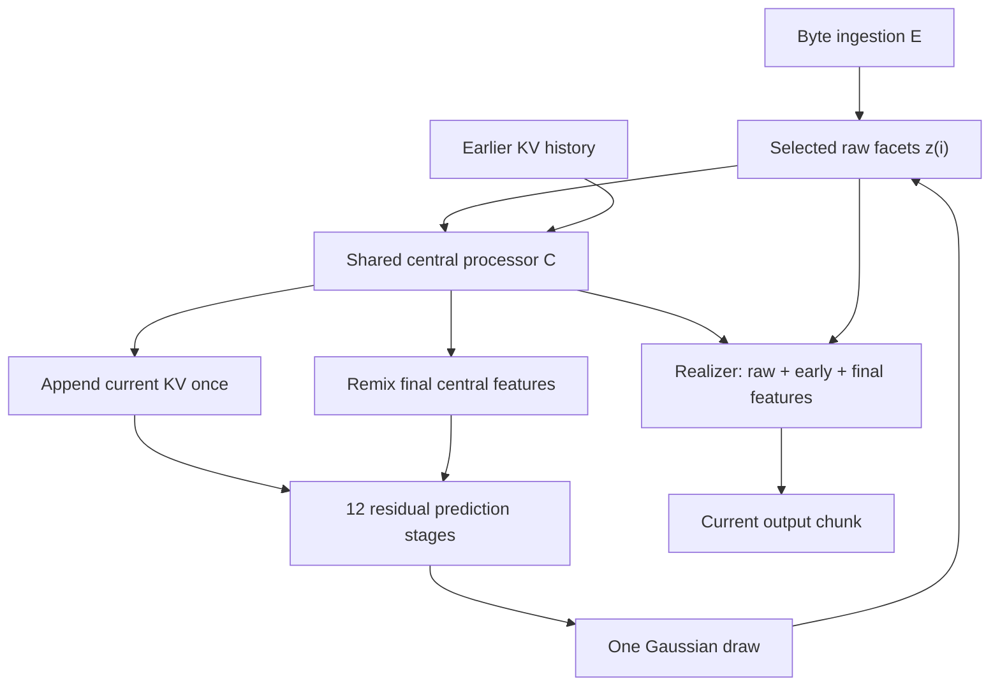

# Architecture v4: shared central processing for prediction and realization

**Both realization and next-chunk prediction use the central core's computation.**
Byte ingestion and prediction meet at one format: **32 raw facets of width 512**.
Each selected input is processed once by the central processor, which reads its
causal history, writes one KV entry, and caches intermediate/final features.
The realizer uses those features to emit the selected chunk. The next predictor
uses the final features to produce the following input. Preserving the raw tensor
means preserving the exact selected input; it does not bypass central processing.

The production preset is `32x512`. `32x256` uses the same architecture at smaller
width. The test preset is four 32-wide facets with a 128-position output limit.
Architecture version 4, tape protocol version 4, and saved model geometry are
explicit. Legacy CLI names `recurrent32` and `compact32` select the corresponding
new presets for fresh construction only; old checkpoints are not reinterpreted.

## Computation and recurrence



For selected input `z(i)` and history through input `i-1`, the computation is:

```text
early(i), final(i) = C(z(i), history(i-1), role(i), position(i))
history(i)         = append(history(i-1), KV(final(i)))
output(i)          = R(z(i), early(i), final(i), public_schema_and_copies)
mean(i+1)          = P(remix(final(i)), history(i), control(i+1), effort(i+1))
z(i+1)             = mean(i+1) + sigma(i+1) * epsilon
```

The raw input, central activations, and historical cache have distinct jobs.
The raw input is the selected recurrent representation. Early/final activations
are reusable computation derived from that input and history. The KV cache is
bounded causal context from previously selected inputs, including the current
one once C has run. These are all explicit fields of the runtime state, with one
model version. No decoded-byte round trip or additional state reconciliation is
needed.

### Work allocation

| Component | Default work | Main responsibility |
| --- | --- | --- |
| Ingestion E | Native byte/ngram frontend, exponential reduction, 2 dense facet blocks | Encode bytes into the common raw input format |
| Central C | 4 dense residual attention/FFN blocks | Contextualize every selected input and write KV; expose blocks 2 and 4 |
| Predictor P | Non-residual remix followed by 12 residual sparse stages | Build the next raw input distribution from processed context |
| Realizer R | 32-slot seeding, progressive position expansion, contextual refinement | Deterministically emit structure, length, bindings, and lexical IDs |

Four central blocks provide meaningful contextual processing without moving the
large sparse prediction bank into the part that outcome RL must freeze. Twelve
predictive blocks retain most depth after the remix. This allocation is a design
choice to validate in training, not an experimentally established optimum.

C and E use the same `DenseFacetBlock` implementation with separate parameters.
P owns one large packed expert bank shared across its twelve stages; each stage
owns its query/output attention projections and dense residual branch. C owns
its own small dense blocks. This separates gradient ownership while sharing
operator code. One central KV projector serves C and P; each block has its own
reader so depth-specific queries can use the same history representation.

### The prediction boundary

The predictor starts with a normalized channel SwiGLU and a learned facet-slot
transform. There is **no identity addition across this remix**. The remix is the
start of prediction, not the completed output. Twelve subsequent residual
attention and pair-expert stages build the final mean in the original `[B,32,D]`
format. That mean has no compulsory output normalization or second reconciled
representation.

Each P stage makes two sequential pair updates; the second reads the first's
result. Fixed pair topology and deterministic incident-facet reductions avoid
unordered CUDA atomics. A route is compiled at the prediction entrance from the
causal seed and fixed stage/row descriptors. Effort 1/2/3/6 selects the active
pair rows. No additional routing exploration is sampled in served execution.

Prospective control and effort enter P once, immediately after the remix.
C processes an already selected input with role/position metadata and history;
it does not inject the next request's controls into that historical record.
This also lets fixed native histories replay without recomputing old P calls.

### Contextual realization

The realizer seeds its expansion with every raw facet identity and early central
features. Growing output positions attend to the early features. A late refinement
reads the raw facets and final central features, with bounded local and pooled
global output interaction. Short outputs still receive information from all
facet slots. The normal path has access to useful C computation in both early
expansion and late refinement.

The original input bytes are not a private source-attention bypass around the
common representation. Public exact-copy catalogs and schema constants remain
explicit deterministic inputs. Raw-only `E -> R` dispatch exists as the bootstrap
codec auxiliary and an explicit inspection path. Normal serving uses `C -> R`.

One selected draw triggers one C pass, one KV append, and one contextual decode.
The returned state already holds C's features for the next prediction. The last
output also uses C because the realizer needs its contextual features, even if no
next prediction follows. The implementation reuses activations; it does not claim
concurrent CUDA streams or overlap of expansion with C's last blocks. Those are
future measured scheduling optimizations.

## Public state APIs and exact chronology

| Operation | Contract |
| --- | --- |
| `initial_state(batch_size, ...)` | Empty history and learned sentinel; no selected record or central cache |
| `encode_chunk(byte_ids, lengths=None)` | History-independent E output in the common raw format |
| `advance_raw(state, raw_facets, role_ids=None, record_ids=None)` | Preserve the exact supplied tensor, run C once, append current KV immediately, cache early/final features, increment the record count |
| `observe(byte_ids, state, ..., encoder_grad=True)` | E(bytes), then the same `advance_raw` path; no processing of the previous input |
| `predict_facets(state, control=None, effort=6)` | Read cached final C features and updated history, remix, run P, return the next mean; do not write history |
| `predict_from_processed(...)` | Explicit alias for the same pure prediction operation |
| `prepare_realization(state)` | Expose raw/early/final features without executing C or changing state |
| `prepare_realization(raw_tensor)` | Explicit raw-only auxiliary/inspection context |
| `encode_control(..., encoder_grad=True)` | Encode public controls; optionally detach shared byte features while keeping the control head trainable |
| `state.detach()` | Cut raw, cached central, and KV activation graphs at an explicit TBPTT boundary |

`CoreState.facets` is the exact selected raw tensor. `early` and `final` are its
cached C activations. `history` already includes that input. `records_seen`
counts every selected real input immediately. The initial sentinel is excluded;
if queried before any observation, it may seed a local C/P calculation without
writing a history record. Prediction on a selected state never repeats C.

The functional APIs return new states. Observing a tool result processes that
result once; the preceding generated action is already present in history.
Invalid or empty decoded actions also remain selected inputs. Validity determines
whether an environment action may be executed, and an actual error response is
a subsequent observation. There is no special facet "commit" operation.

After an optimizer update, derived caches must be rebuilt from ordered observed
bytes and exact raw native tapes under the new weights. Re-encoding emitted bytes
cannot in general recover a selected latent tensor. Partial episode resets mask
only the reset rows' history and remove their cached computation; model/routing
version mismatches and incompatible geometry are rejected.

## Hierarchical byte/ngram ingestion

E starts with ordered native bytes plus exact/hashed n-grams. The production
native table has 2,500,000 rows of width 16: 40,000,000 parameters. Unigrams and
bigrams have exact addresses; higher-order hashed lookups are an explicit fallback.
Separate ordered byte features retain case, zero bytes, byte order, and boundaries.
No pretrained donor is needed for random initialization.

The stride-eight frontend produces source-width features. A shared ordered pair
merge halves the sequence at each level, followed by bounded local attention and
a shared FFN. Only the final at-most-32 source positions enter facet query
attention. An aligned readout preserves ordering while query attention fills the
canonical facet block. Two dense refinement blocks then operate at facet
resolution, followed by an unconstrained-scale output projection.

Each padded batch row uses the first reduction level at which it is ready. A
longer unrelated row therefore cannot change a short row's representation. When
lengths are implicit and uniform, the encoder skips intermediate readouts and
performs one terminal readout. This fast path has output and parameter-gradient
parity with explicit uniform lengths, without a device-to-host length check.

`byte-pyramid-v2` identifies this ingestion implementation. Role, history, future
controls, and next-target labels are excluded from E. C applies role/position
separately. Native n-gram ownership stays at `core.frontend.ngrams`; optional
import, rounding-aware bake, optimizer moment reset, and serving use that owner.

## Correspondence, reconstruction, and gradient ownership

Both supervised modes first make the causal prediction before exposing the next
target's bytes. They supervise the **completed** prediction after all twelve P
blocks, and both evaluate a main contextual output pass plus reconstruction.
The exact losses and normalization live in [training.md](training.md).

**Bootstrap** uses the target encoding as a Gaussian codec distribution with
positive standard deviation, initially 0.1. A noisy E draw directly feeds the
raw-only realizer auxiliary, training E and R. An analytic
`KL(stop_gradient(q_E) || p)` teaches P the complete distribution, including its
variance. The main causal prior sample goes through C and contextual R for output
supervision. The next live training input is the encoded target: teacher forcing.
The teacher input and hypothetical sampled output are alternative branches from
the same pre-action history, never consecutive history writes.

**Recurrent training** retains the sampled prediction and its graph through the
next selected input and within the configured recurrent tower. Main losses train
C, P, and R through that trajectory. Observation/control frontend paths detach E.
A separate E reconstruction branch uses the same contextual C/R computation with
its parameters and pre-action history detached. Gradients through the branch's
input still train E; its loss cannot update C, P, KV owners, or R.

Direct E-to-facet following is available only for a genuine saved raw sample
paired with its actual deterministic emitted bytes. Ordinary offline text does
not provide that identity. Regressing observed next bytes toward an unrelated
forecast would train an inverse of an event that did not happen. Native following
is optional because identical bytes can correspond to multiple contextual latent
states; reconstruction and recurrent quality must be monitored alongside it.

The only stochastic served choice is the diagonal Gaussian over all `32 x D`
final coordinates, with initial prior standard deviation 0.1. Length, structure,
bindings, lexical argmax, and byte materialization are deterministic given the
sample, causal history, and public schema/copy context. The Gaussian density is a
latent action density, not the probability of the resulting bytes.

Outcome RL must freeze the complete conditional action map: **E, C, shared KV
projection, and R**, including core-owned U transforms. P, its remix, controls,
and Gaussian scale remain trainable. The `encoder_parameters`,
`central_parameters`, `predictor_parameters`, and `realizer_parameters` interfaces
expose disjoint owners without duplicate registration. Separate gradient clipping
keeps the encoder-only auxiliary from rescaling main recurrent gradients.

## Public controls and replay

Training, evaluation, serving, student collection, and density scoring share
`controls.build_control_payload` and `controls.encode_controls`. Seed bytes remain
unchanged. Nonempty references follow `\n<reference>\n`; public tools follow
`\n<tools>\n`. Only tool JSON is canonicalized. References require an
`external_evidence` or `earlier_history` origin; future targets and verifier
outcomes are excluded. Absent controls encode to exact zero, including empty rows
in a mixed batch. Public controls create no extra observation or KV record.

Every `fmt-canonical-facets-v4` tape owns its control source and complete FP32 raw
draw. Density scoring re-encodes those controls and requires a matching conditional
materialization. Fixed raw-history replay skips P and runs only E for observations
and C for each selected input. Both use the same versioned history chronology.
Serving separates textual `control_seed` from the Gaussian RNG's numeric `seed`.
See [generation.md](generation.md) for tape and decoder details.

## Width, KV sharing, and cost

| Geometry | `32x512` | `32x256` |
| --- | ---: | ---: |
| Raw facets | `32 x 512` | `32 x 256` |
| Coordinates per prediction | 16,384 | 8,192 |
| Source width | 256 | 128 |
| E/C dense hidden width | 1,024 | 512 |
| Attention queries | `4 x 128 = 512` | `4 x 64 = 256` |
| Keys, separately values | `2 x 128 = 256` | `2 x 64 = 128` |
| Concatenated P row width | 1,024 | 512 |
| P experts / hidden width | `64 / 1536` | `64 / 1536` |
| Stage-private P dense hidden width | 1,024 | 1,024 |
| U experts / hidden width | `32 / 1024` | `32 / 1024` |
| Recent / archived historical slots per input | 32 / 2 | 32 / 2 |
| Maximum cached chunks | 1,024 | 1,024 |
| Maximum BF16 projected KV per episode | 3.875 MiB | 1.938 MiB |
| One FP32 raw sampled input | 64 KiB | 32 KiB |
| Maximum output positions | 1,024 | 1,024 |

Width 512 is the primary training choice: 32 slots still carry 16,384 coordinates,
while full-width queries and 256-wide K and V avoid an unusually narrow history
interface. Every C/P layer can read the same 32-slot history through its own query
and output projection. `history_slots < n_facets` is a compressed ablation, not
the default. Additional width and KV heads are configurable experiments; their
quality benefit is not established by parameter counts.

At production width a new full-resolution record uses 32,768 bytes of projected
KV. The latest 64 records keep all 32 slots; earlier records are compressed to two
masked, differentiable coarse slots. At 1,024 retained records this is
`(64*32 + 960*2) * 1,024 = 4,063,232` bytes (3.875 MiB). The compression
changes the trained history representation; it does not promise exact retrieval
of every old full-resolution slot. This excludes raw facets, central caches,
masks, decoder workspaces, and optimizer state.

Counting a multiply and add as two FLOPs, one selected P row uses
`6 x (2D) x (1536 + 1024)` matrix FLOPs. Full effort evaluates 96 pair rows per P
stage, or 1,152 over twelve stages: **18.119 GFLOPs** at width 512, half that at
width 256. This scoped count excludes C, E, attention, routing, padding, output
realization, nonlinearities, and backward. Parameter and FLOP arithmetic is not
an end-to-end throughput measurement.

At the 3,968-slot recent-plus-archive bound, sixteen C/P reads with 32
queries and combined query width 512 require up to approximately 4.16 GFLOPs
of historical QK/AV products. The old record summaries remain causally
readable but are lower resolution. Actual concatenation, compression, and
grouped expert costs still require Blackwell profiling.

Unpadded attention passes `attn_mask=None` to preserve fused SDPA eligibility.
Partial resets and padded/empty sources retain real masks. See the
[PyTorch SDPA API](https://docs.pytorch.org/docs/2.10/generated/torch.nn.functional.scaled_dot_product_attention.html)
for supported grouped-query backends and numerical differences. The hardware gate
checks forward/backward parity at both production widths and long history.

## Evidence and implementation boundaries

The allocation follows a useful principle from hierarchical byte models: keep
fine-grained encoding/decoding relatively small and devote most capacity to
processing a compressed representation. [H-Net](https://arxiv.org/html/2507.07955v2)
and [BLT](https://arxiv.org/html/2412.09871v1) provide evidence for hierarchical
processing and contextual decoding, with different chunking and decoder designs.
They do not validate this model's paragraph-scale 32-facet bottleneck or its
single-draw deterministic realizer. Those are our choices to test. The reasoning
and alternatives are recorded in [ADR 0004](decisions/0004-contextual-realization.md).

The CPU suite checks central reuse in both branches, exact raw identity, immediate
history writes, pure prediction, live recurrent gradients, checkpoint parity,
encoder-only ownership, deterministic replay, masking, and version rejection.
The [validation report](validation.md) gives actual receipts and owner counts.
The [Blackwell runbook](blackwell.md) covers device execution, full-vocabulary
memory fit, throughput, and quality gates before committing a long training run.
