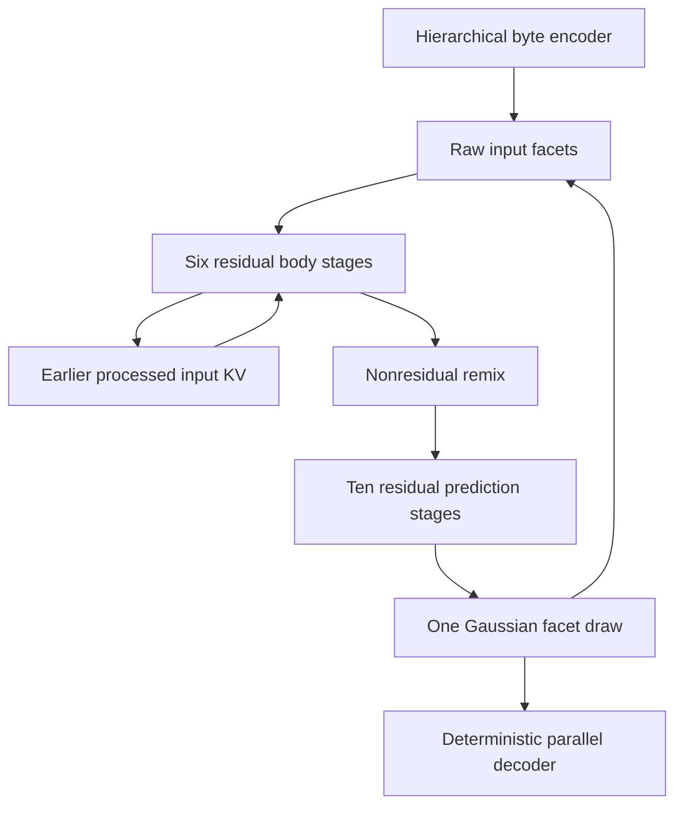

# Generation, raw facet recurrence, and exact bytes

`FacetedGenerator` shares one implementation between supervised training,
deterministic decoding, stochastic generation, and policy replay. `FacetedCore`
owns the byte encoder, recurrent attention computation, and shared expert banks.
The generator adds a Gaussian scale head and a parallel deterministic decoder;
serving uses those same parameter owners.

## The tensor that decodes is the tensor that recurs

Architecture version 3 uses 32 input facets. The primary `recurrent32` profile
has width 512; `compact32` has width 256. The core runs six residual body stages,
a nonresidual remix, and ten residual prediction stages. The completed prediction
has the same coordinates and geometry as the input facets.



The Gaussian mean is the completed prediction tensor, without a separate learned
mean projection or output normalization. A bounded diagonal scale head sees that
mean. One FP32 Gaussian draw supplies all facet coordinates. The resulting tensor
is passed directly to both the decoder and the next core iteration. Control enters
the core once; there is no second control or learned causal-state path into the
decoder. The decoder also receives public schema descriptions and exact copy
sources made available by the caller.

`CoreState.facets` is the current **unprocessed** input. Its bounded history KV
contains only earlier processed inputs. `core.process(state)` consumes the pending
input through the body, appends its processed features once, runs the remix and
prediction stages, and returns the completed next facets with the updated history.
`core.replace_facets(processed_state, tensor)` replaces that pending tensor and
preserves the history; it performs no neural computation. Sampling uses this
operation to install the one Gaussian draw.

For an external observation, `core.observe(bytes, state, ...)` processes any
previous pending input through the same body and then installs `E(observed_bytes)`.
This preserves context across consecutive system, user, tool, or document records.
The initial state is a sentinel without a real pending input. `records_seen` counts
processed real inputs and excludes the current pending input; it is not a count of
all events already presented to the API.

Generated bytes are never re-encoded to replace the generated facets. In particular,
the model does not require or claim that `E(D(z)) == z`. Encoding and prediction
share a learned coordinate space; reconstruction and the representation objectives
below teach their relationship. Every selected finite facet tensor becomes the next
input, including one whose decoded action fails validation. Validity controls
execution eligibility, not the recurrence of the computation.

## Supervised modes and gradient directions

A prepared target specifies `representation_mode="bootstrap"` or
`representation_mode="recurrent"`. The plan is authoritative: passing a conflicting
mode to the forward call raises an error. The supplied curriculum uses bootstrap
for B0 and recurrent mode for P1, M1, M2, LC, S, and D. The trainer's `auto` setting
resolves to that phase policy.

Let `mu` be the completed predicted facets, `z` the one reparameterized Gaussian
draw, and `e = E(target_bytes)`. Both modes train the served decoder on `z` using
teacher-forced lengths, structural choices, and free lexical targets. Their
representation objectives and next inputs differ:

| Property | Bootstrap | Recurrent |
| --- | --- | --- |
| Served decoder loss | `D(z)` predicts the target | `D(z)` predicts the target |
| Encoder reconstruction | `D(e)` predicts the target; trains E and shared D | No reconstruction decoder pass |
| Representation objective | Gaussian negative log density of `stop_gradient(e)`; trains prediction and scale | Squared error of `e` against `stop_gradient(mu)`; trains only E |
| Next pending input | `e`, installed by pure replacement | `z`, retained live in the computation graph |
| Decoder passes | Two | One |
| Lexical P for F free positions | `2 * F` | `F` |

Bootstrap supplies a byte-anchored reconstruction problem and teaches the next-facet
predictor to match it. Later, actual future token losses determine the recurrent
model's useful representation. The encoder follows detached completed predictions;
its alignment loss cannot pull the recurrent model or decoder toward an encoder
representation. There is no target-dependent posterior and no target-byte input to
the current served prediction.

Keep the returned recurrent state live across the prediction tower. Detach only at
an explicit truncated backpropagation boundary. For actual observations in recurrent
training, use `encoder_grad=False`: this detaches their encoder output while keeping
the shared body and historical attention computation differentiable. The trainer
can anchor an offline teacher prefix with encoded records at a declared window
boundary. Native generated history with saved tapes can replay its original raw
facet events. These boundary policies are explicit; a teacher record is not silently
substituted for every generated input inside the recurrent tower.

`training.history.NativeHistory` validates native annotations against their physical
record cursors, exact IDs, and facet geometry. Invalid and valid empty draws can
share a cursor because they produce no physical record. Prefix replay includes a
native record's own tape and skips encoding that record. Before a scored target,
the index returns only earlier zero-record draws, excluding the target's future
facets. `replay_raw_tape` uses the shared body-only `core.advance_raw` transition:
it rebuilds processed context and installs the fixed raw input without decoding,
sampling, or running an unused prediction stack.

### Public training API

```python
import torch
from megatoken.contracts import DEFAULT_LOSS_WEIGHTS
from megatoken.generation import ByteCodec, FacetedGenerator
from megatoken.model import FacetedCore, ModelConfig
from megatoken.tensors import byte_tensor

config = ModelConfig.tiny(max_capacity=32)
model = FacetedGenerator(FacetedCore(config), ByteCodec.byte_fallback())
state = model.core.initial_state(batch_size=2)
prompts, lengths = byte_tensor([b"first prompt", b"second prompt"], state.device)
state = model.core.observe(
    prompts,
    state,
    lengths=lengths,
    role_ids=torch.tensor([1, 1]),
    encoder_grad=False,
)
plan = model.prepare_target(
    target_bytes=[b"first continuation", b"second continuation"],
    capacity=32,
    terminal=[False, True],
    representation_mode="recurrent",
)
result = model.supervised_step(state, plan=plan)
next_state = result.state  # Pass this live state to another step within the tower.
# This local reduction illustrates the contract. The trainer normalizes globally.
loss = sum(
    DEFAULT_LOSS_WEIGHTS[name] * value / count
    for name, (value, count) in result.losses.items()
    if count
)
# Add losses from any further tower steps before this one window-level backward.
loss.backward()
```

Every loss is an unweighted scalar **sum** with its actual integer denominator.
The production trainer aggregates denominators over accumulation and replicas
before applying weights once. Host-side preparation makes all denominators
available before a model forward; the forward checks them against the losses it
actually evaluated. Microbatch graphs need not be retained just to discover their
normalizers.

The shared loss names are `lexical`, `reconstruction`, `structure`, `binding`,
`placement`, `terminal`, `facet_prediction`, `encoder_alignment`, `router_balance`,
and `router_z`. Inactive objectives have denominator zero. Each reconstruction or
prior pass contributes its own structural decisions. P and U routing losses remain
unweighted until the trainer applies the shared curriculum weights.

`prepare_target` accepts either exact `target_ids` or `target_bytes`. Supplied IDs
retain their original segmentation. `free_mask` has one entry per actual target
ID: padding, copied values, and fixed syntax excluded by the prepared record do not
become extra lexical positions. Raw supervision batches independent episodes with
a common decoder workspace capacity. Typed actions currently execute one episode
per forward; the trainer accumulates those examples. Role IDs are system 0, user 1,
assistant 2, tool 3, document 4, and environment 5; emission targets default to 2.

Diagnostics include separate prior and reconstruction loss sums and position
counts, both representation objectives, predicted and encoded facet norm sums,
and alignment squared-error sums. Divide norm sums by `facet_examples` and squared
error by `facet_alignment_coordinates`. Numerical diagnostics remain detached
scalar tensors until transaction logging; static counts are ordinary integers.
These measurements expose decoder dependence on reconstruction and representation
drift without adding another training objective.

## Deterministic parallel realization

The same decoder executes teacher-forced training and deterministic materialization.
It selects text or an available schema, exact field lengths, bindings, identifier
values, permitted key order, copy placement, and terminal status. Inference uses
argmax over each feasible support; training evaluates the corresponding masked
cross-entropy. A choice is conditioned into the shared structure header before its
descendants. Public schema descriptions are encoded by shared vocabulary owners,
so schema identity is not just a position in a list.

After length selection, workspace capacity is the next fitting power of two,
clamped by the configured hard limit. Shared binary growth expands a small row
seed, with the same U expert bank at each level. Local attention, pooled global
attention, and cross-attention to the raw completed facets refine the position
rows. The final lexical refinement uses the shared dense U path. Each ordinary
free position is decoded in parallel. Early identifiers use the same vocabulary
machinery and are reused at every bound occurrence.

The model hard limit is 1,024 output positions in production. The default public
text request permits at most 512, or the model's smaller configured maximum.
The data chunker's target of 256 is a boundary preference, not a forced generated
length. The exact length head learns from semantic chunk targets. Tiny CPU profiles
use smaller limits. The final serialized output must also fit the public and model
limits, including fixed JSON punctuation, copied bytes, and escaped strings.

Masks remove special/padded vocabulary rows and enforce the requested local byte
alphabet. They do not turn parallel independent lexical choices into a grammar
parser: completed UTF-8 and JSON values are validated after materialization.
Invalid output is returned with `valid=False` and an error. There is no hidden
retry, stochastic repair pass, or extra Gaussian draw. An application can observe
validation feedback and request a subsequent chunk.

### Structured values, identifiers, and exact copies

`ActionSpec` carries causal `SchemaSpec` objects and `CopySource` byte payloads.
Fields support UTF-8 strings, ASCII, identifiers, arbitrary byte values where the
output representation allows them, and raw JSON values with a declared JSON
Schema. Raw JSON fields preserve nested objects, arrays, numbers, booleans, and
nulls. `fixed_json` supplies deterministic constants. Local schema references are
supported; network schema retrieval is disabled. OpenAI-style JSON argument strings
are explicitly checked against their declared `contentSchema` after decoding.

A field can define an identifier or reference an earlier definition. A copied
identifier and its bound uses have no free lexical target. A generated definition
has one lexical target sequence per decoder pass; its later occurrences reuse the
exact value. Copy binding and placement heads train on their own categorical
choices. Copied bytes come from declared causal sources, with source IDs verified
against those bytes. The typed schema serializer creates fixed keys, punctuation,
and JSON escaping deterministically.

`prepare_action_target(payload, spec=..., schema_index=..., ...)` returns the exact
canonical typed serialization in `plan.payload`. The trainer uses typed supervision
only when that serialization matches the actual record bytes. Otherwise it retains
the record and uses its raw lexical mask. Data preparation can exclude known fixed
syntax using a causal public schema; unsupported legacy envelopes retain their
explicit raw-text objective. This fallback is a supervised decoder objective,
not an additional policy likelihood.

The typed decoder's final `emitted_ids` encode the complete serialized payload.
Its free-value target IDs are accounted for separately during teacher forcing.
Raw text output preserves the IDs selected at its lexical positions. In both
cases the exact external contract is `codec.decode(emitted_ids) == payload`.

## The raw Ling codec

The offline bootstrap is a complete 256-row vocabulary where token ID equals byte
value. It represents NUL, arbitrary binary payloads, invalid UTF-8, and empty input.
It is separate from the production tokenizer.

Production imports the output mapping from the following pinned asset; importing
the codec does not download donor model weights:

| Asset | Pin |
| --- | --- |
| Repository | `inclusionAI/Ling-3.0-tiny` |
| Revision | `9a98e35fe1c9ee255f78dd64771c7ae15a799481` |
| File | `tokenizer.json` |
| File SHA256 | `40fb9d7d7795b8bd305aeff39ce9963f3f450915b9553f2938e009be9a1fed60` |
| Output rows | 157,184 |
| Lexically emittable base rows | 156,891 |
| Codec version | `raw-byte-bpe-v2;binary=single-byte-v1;special-merges=masked` |
| Codec fingerprint | `7f52faca2fe82273a889023defd2f1a6fd6080a21096ec77e97f4798a0a370b2` |

The raw mapping disables Unicode normalization, inserted prefixes, postprocessing,
and added-token interpretation. Special and padded rows cannot occur at a free
lexical position. When an added special token reuses a base BPE row, both the Rust
and manual encoders remove merges that would create or consume that masked piece.
Direct multi-byte lookup cannot bypass this restriction. Literal special-looking
text therefore remains representable through legal lexical pieces.

Valid UTF-8 follows the tokenizer's pinned split pattern and legal BPE merges.
Invalid UTF-8 uses a versioned one-byte encoding convention, with no replacement
characters. A manual implementation provides the same raw mapping if the optional
Rust tokenizer backend is unavailable. The codec module and lazy generation package
can be imported by preprocessing workers without importing PyTorch.

The codec fingerprint is part of prepared datasets, checkpoints, tapes, and served
bundles. Changing normalization, masked merges, binary encoding, or the asset
changes that identity. Old caches must be rebuilt under the matching identity;
reinterpreting old IDs with a new mapping is not a migration.

## Full vocabulary without a full saved logit matrix

`TiedVocabulary` uses one rank projection and one vocabulary embedding. Production
output rank is 128. Cross-entropy and exact deterministic argmax scan the complete
allowed vocabulary in position and vocabulary tiles. The custom first-order
cross-entropy backward recomputes each tile and accumulates hidden and weight
gradients; it never saves a length-by-vocabulary matrix for backward. Argmax uses
the same full support and resolves exact ties to the lowest row ID. It consumes
no random numbers and uses no top-k or top-p truncation.

CPU FP64 tests compare values and both gradients against dense masked
cross-entropy. On CUDA, BF16/FP16 matrix operands request FP32 output accumulation
through `torch.mm(..., out_dtype=torch.float32)`; normalizers and accumulated
gradients remain FP32. `tensorcore=False` selects the FP32 numerical reference.
This reduces saved-logit memory; it does not remove full-vocabulary arithmetic.
CUDA numerical parity and Blackwell throughput remain separate hardware gates.

Decoder attention reuses the core's grouped-query attention abstraction and the
configured query/KV widths. Fully valid attention passes `mask=None`; padding uses
an explicit correct mask. This preserves eligibility for the appropriate fused
attention backend without claiming that every masked case has the same kernel.

## One-event tapes and latent policy gradients

`sample` returns a `PolicyResult` with exact bytes, emitted IDs, updated state, an
immutable `ActionTape`, and the summed Gaussian log density. `score_tape` reconstructs
the candidate causal computation, evaluates that same recorded facet event, reruns
the deterministic decoder, and verifies bytes, IDs, deterministic choice trace,
validation result, and terminal status. Candidate weights build their own routing
programs and historical KV; the tape contains no authoritative route or hidden cache.

The tape version is `fmt-canonical-facets-v3`. It records the complete FP32 facet
coordinates and geometry, codec and public-spec fingerprints, effort, role, output,
validation error, behavior density, and exact causal `control_payload` bytes.
Deterministic choices are an audit trace, not additional probability factors.
Earlier tape versions are rejected because they do not provide this complete
conditional event contract. A tape uses `valid`, not a separate state-commit flag.

`controls.build_control_payload` is shared by training, serving, collection, and
RL. It preserves seed/reference bytes, validates declared reference provenance,
and canonicalizes only the public tool JSON. Stochastic policy methods accept
these raw bytes; the tape stores them in the same strict base64 byte representation
as its output. `score_tape` and native history replay encode the recorded bytes
under current weights automatically. A supplied scoring override must match those
bytes exactly. No caller-supplied tensor or separate replay control list can
silently change the condition.

The shared control encoder remains differentiable in replay, while its byte
frontend is detached. This keeps the recurrent encoder-following objective
isolated without freezing the learned control path. An absent control is exactly
neutral: an all-empty batch bypasses encoding, and empty rows in a mixed batch
are zeroed explicitly.

```python
from megatoken.generation import ActionSpec
from megatoken.controls import build_control_payload

initial = model.core.initial_state(1)
spec = ActionSpec(text_kind="ascii", min_tokens=4, max_tokens=8)
control_payload = build_control_payload(seed=b"Use concise wording")
result = model.sample(
    initial,
    spec=spec,
    generator=torch.Generator().manual_seed(42),
    control_payload=control_payload,
)
replayed = model.score_tape(initial, result.tape, spec=spec)
torch.testing.assert_close(result.log_prob, replayed.log_prob, rtol=0, atol=1e-4)
assert torch.equal(result.state.facets, replayed.state.facets)
assert model.codec.decode(result.emitted_ids) == result.payload

# Inspect either representation with the same deterministic action map.
mean_output = model.decode_mean(initial, spec=spec, control_payload=control_payload)
encoded, lengths = byte_tensor([b"example"], initial.device)
encoded_output = model.decode_facets(
    model.core.encode_chunk(encoded, lengths=lengths),
    spec=spec,
)
```

`decode_mean` inspects the completed mean without returning an advanced state;
`decode_facets` decodes a supplied finite tensor without running the core. Neither
samples. Small floating-point differences in recomputed attention intermediates
can occur between collection and differentiable replay, so numerical parity gates
use explicit tolerances. The saved raw facet coordinates themselves are reused
exactly.

Outcome RL scores the density of the **latent facet action**, not a text
likelihood. One production action has `32 * 512 = 16,384` latent coordinates.
`PolicyResult.scored_positions` and `ActionTape.scored_positions` are zero;
`latent_dimensions` exposes the coordinate count. The R-stage budget uses Z, the
number of sampled latent coordinates. D and I remain reference token counts of
actual record bytes; supervised P counts actual free decoder targets in the active
mode. These units cannot be compared as if they were interchangeable.

For latent-only RL, call `freeze_decoder_for_rl()` after constructing or loading
the optimizer. It freezes the canonical encoder and all owners of the deterministic
facet-to-action map, including shared U experts, and clears their gradients.
Predictive core owners and the Gaussian scale remain trainable. Freezing the action
map makes replay of a fixed latent event describe the same action while the policy
density changes; updating that map without its own gradient estimator would break
this objective. Frozen owners remain present in the optimizer checkpoint and have
no gradients or weight-decay updates.

`replay(initial_state, records, specs=...)` accepts exact observations
and raw tapes in order. `Observation(payload, role_id)` retains ownership; bare
bytes are interpreted as tool observations. Supply the original causal public
specification for each action; every tape owns its causal control bytes. The helper
retains the differentiable short-episode history. An explicit detach boundary
changes that to a truncated recurrent policy-gradient approximation.

The RL trainer collects current-policy rollouts, executes valid actions, verifies
the environment outcome, and rebuilds each candidate trajectory before updating.
A same-weight replay gate runs before the optimizer. Equal-reward groups skip the
optimizer entirely; task and episode ceilings still apply even when all lexical
values are public constants. RL episode termination belongs to the environment's
`done` response or the configured step limit. A decoded terminal flag alone does
not end an environment task.

## Export and stateful serving

`export_served` writes an immutable checksummed safetensors bundle with model
configuration, precision, model/routing versions, codec identity, and semantic
chunking identity. A production tokenizer asset is bundled locally. Every shared
encoder, decoder, and predictor owner is retained. There is no training-only
posterior to remove; `training_heads=False` disables supervised entry points while
preserving the same served action map. Optional donor imports must be baked before
export, so serving does not depend on a donor checkpoint.

```bash
megatoken export --checkpoint runs/b0/checkpoints/latest.json --output served/b0 --codec byte
megatoken generate --model served/b0 --prompt "Hello" --max-tokens 32 --seed 17
megatoken serve --model served/b0
```

For a production checkpoint, pass its matching tokenizer path instead of `byte`.
The CLI's `--tools` file supplies the same public descriptions to the predictor
and schema compiler. `--control-seed-file` and `--control-reference-file` read
exact raw bytes; a reference also requires `--reference-origin external_evidence`
or `--reference-origin earlier_history`. These controls remain distinct from the
numeric `--seed` that selects the Gaussian draw.

The export destination must not already exist. `InferenceEngine` checks bundle
hashes before loading and creates model-bound `Session` objects. Observations use
the same semantic chunker as preparation. `observe_physical` preserves an already
prepared physical boundary. Generation updates the session with the raw facet
event regardless of its validation outcome and retains the complete event stream
for replay.

The local JSONL server opens no network socket. It supports `open`, `observe`,
`generate`, `status`, and `close`. First send `{"op":"open","id":1}` and use the
returned session ID on subsequent requests:

```json
{"op":"observe","session":"SESSION_ID","text":"Hello","role":"user","id":2}
{"op":"generate","session":"SESSION_ID","max_tokens":32,"kind":"utf8","seed":17,"id":3}
{"op":"status","session":"SESSION_ID","id":4}
{"op":"close","session":"SESSION_ID","id":5}
```

Use `payload_b64` instead of `text` for arbitrary observation bytes. Generated
responses always include `payload_b64`, exact IDs, `valid`, terminal status, the
tape, Gaussian density, and latent dimension count. `text` is added only for valid
UTF-8. Public tool schemas can be supplied on `generate`; canonical, OpenAI, and
Anthropic wire formats use the shared compiler. The same public tool list also
conditions the facet predictor. Optional `control_seed` and `control_reference`
fields accept UTF-8 strings. References require `reference_origin` to name
`external_evidence` or `earlier_history`. The numeric sampling `seed` is separate
from these model input bytes. Python callers use `InferenceEngine.generate` with
the corresponding byte-valued controls and `tools_json`, including binary control
bytes when needed.

Decoder temperature, top-k, top-p, and repair options are rejected because the
action has one Gaussian event and a deterministic downstream path.

The CPU suite covers byte fidelity, codec masking, tiled loss gradients,
bootstrap/recurrent gradient direction, live multi-chunk recurrence, typed values,
exact copies, invalid-action chronology, latent replay, and a learnable tiny byte
task. Those checks establish implementation behavior. Model quality and Blackwell
throughput require the staged training and hardware validation described in
[training.md](training.md) and [blackwell.md](blackwell.md).
