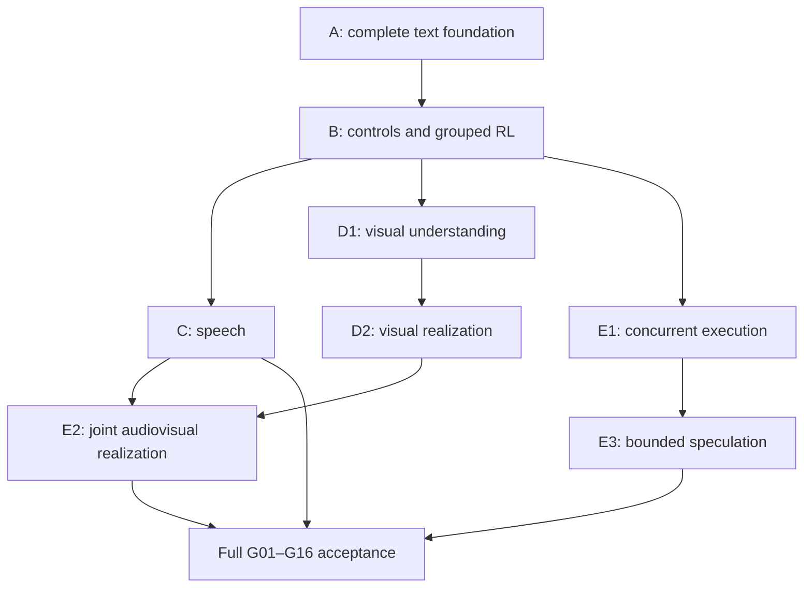

> **Historical plan (written for v7):** The contextual C→R edge here is superseded by
> [ADR 0007](decisions/0007-direct-realization.md), and the **media ingestion and
> realization design in Sections 8-10 is superseded by [media.md](media.md)**: the
> implemented path has one input (pinned EmbeddingGemma2 hidden states) and one
> output per modality (frozen Pocket, Sana and Sana-Video with trainable
> `FacetCondition`s). Where this plan describes per-modality stems, codec input
> features, flow heads trained from scratch, or shared U-bank media realizers, read
> those passages (including the matching asset tables, work packages C/D and
> acceptance gates G05/G08 later on) as alternatives that were considered, not as
> current behavior.
> Task and data directions are tracked in
> [pretrained-omnimodal-bottleneck-plan.md](pretrained-omnimodal-bottleneck-plan.md).

# Multi-track Megatoken: architecture and implementation plan

**Status:** Full-scope implementation contract. All work packages are required in one end-to-end implementation effort. This document specifies required work; it does not assert that the capabilities are already implemented.

**Date:** 2026-10-19.

**Reviewed baseline:** `main` at [`3605ca48921bc2ccefd52b25b49ea92b574d06e0`](https://github.com/werg/megatoken/commit/3605ca48921bc2ccefd52b25b49ea92b574d06e0), architecture v6, including merged recursive-parser chunking PR #6. The review began with the original plan at `6d33c127bb4b358ef9d5eb8dfa51769e1315b301` and was refreshed against the intervening changes before delivery. The next architecture is referred to as v7. This document does not itself change runtime versions, training configurations, or existing architecture decisions.

**Review outcome:** keep the shared-core design and implement the entire roadmap through one integrated delivery. Text, speech, translation, images, video, joint audiovisual realization, controls, retrieval, cooperating sub-agents, concurrent tools, speculation, training, migration, and serving are all required. Empirical uncertainty is resolved through implementation, measurement, and correction within this effort; it does not make any work package optional.

## Execution and completion contract

**Implement every requirement in sections 1–21 and every work package A1–A5, B, C1–C3, D1–D2, and E1–E3. Complete the full acceptance matrix in section 20 before declaring the roadmap implemented.**

The ordering in this document expresses engineering and training dependencies inside one effort. Work may be parallelized and organized into reviewable commits, but an intermediate package, text-only demonstration, adapter skeleton, or partial release is not completion. The delivered system must contain every capability behind the shared E/C/P/R, event, control, training, and serving contracts and demonstrate them together.

The implementation owner must:

1. Carry the work from contracts and data acquisition through functioning code, trained integrated checkpoints, migration, export, serving, evaluation, and documentation.
2. Resolve codec/data selection, version pinning, bilingual and paired audiovisual data, resource configuration, and integration conflicts as implementation tasks. These are not follow-up placeholders.
3. Treat failed tests, weak conditioning use, missed quality targets, excessive latency, or memory failures as unfinished work to diagnose, fix, and revalidate within this effort. Do not remove a capability, disable its required path, lower a held-out threshold after seeing the result, or label it experimental to claim completion.
4. Replace stubs, mocks, feature-only interfaces, and unexecuted recipes with the actual paths and evidence required by section 20. Fixtures support correctness tests; they do not replace real modality training, real concurrent execution, or the integrated acceptance run.
5. Preserve honest status. A concrete external access, asset-rights, or compute blocker leaves the affected requirement and overall roadmap incomplete until resolved. Report its exact impact and continue independent work; never convert the blocker into an implicit scope reduction or fabricate a passing receipt.

Terms such as **bootstrap**, **first**, and **then** refer only to dependency order within this delivery. The final acceptance decision is conjunctive: every required capability and cross-cutting contract must pass. Implementation choices that are explicitly excluded from the selected architecture are listed as non-goals; there is no deferred-feature backlog in this plan.

## 1. The decision in one page

Build **one block-causal transformer over multiple tracks of megatokens**, not a collection of independent transformers connected by bridges.

Every modality enters the central model as the same `32 x 512` raw facet block. A **meridian** is a set of selected megatokens processed together. Its members can attend fully to one another and to earlier meridians. All tracks use the same central processor, predictor, expert banks, and projected historical KV space. Modality-specific encoders and realizers handle the high-resolution work at the edges.

The intended system supports text, speech, images, video, translation, cooperating sub-agents, retrieval, and parallel tools through the same event model. It prioritizes coherent, information-dense chunks over frame-level semantic updates.

| Area | Required design |
| --- | --- |
| Canonical representation | Keep 32 facets per megatoken and the existing 512/256 widths |
| Causal unit | An atomic meridian containing one or more megatokens |
| Same-meridian interaction | Joint attention over selected facets, before one final KV publication |
| Prediction | One shared P12 operating on all requested output blocks together |
| Historical memory | One session-level KV store; all 32 slots retained per stored megatoken |
| Temporal structure | Causal meridian index plus separate media timing/alignment metadata |
| Positions | Logical-time RoPE in the core; categorical track relations; spatial/time positions inside modality adapters |
| Chunk policy | Text-scale semantic chunks for every modality; codec frames remain internal |
| Parameter sharing | Share core and prediction experts; share encoder/realizer structure and compatible weights within ownership boundaries |
| Realization | Existing lexical realizer plus an audio realizer and a shared image/video family |
| Controls | One versioned control source with predictor and realizer consumers; ordinary prompts remain first-class |
| Runtime | A ready-event scheduler and bounded speculative branches, not a general distributed graph engine |
| Delivery | One integrated implementation of the complete text, media, training, migration, and concurrent-runtime roadmap |

The central architectural change is small to state:

```text
v6: selected [32, D]       -> C -> one block of final KV -> R and next P
v7: selected [T, 32, D]    -> C -> T blocks of final KV  -> per-output R and next joint P
```

`T` is the number of active events in this meridian, not the number of allocated tracks. An inactive track creates no placeholder megatoken, no Gaussian draw, and no KV entry.

### What improves on the earlier proposal

The plan makes several choices explicit rather than accumulating mechanisms:

- **Remove the central preview/reprocessing pass.** Observations are committed before predictions that depend on them. Each selected event still receives one central pass.
- **Separate a causal meridian from a media time interval.** Two events can depict the same interval without becoming circularly dependent predictions.
- **Use ordinary block-causal execution instead of a general event-DAG attention engine.** Dependency metadata determines scheduling; the model consumes a simple ordered sequence of meridians.
- **Do not make track IDs a rotary spatial axis.** Track identity is categorical; physical time and spatial coordinates have different meanings.
- **Do not require a hidden high-resolution residual memory.** The semantic path uses megatokens. Detailed assets are explicit references for tasks that request them.
- **Do not partition expert counts prematurely.** Begin with shared banks and modality-aware conditioning. Add specialization only where it produces a demonstrated benefit.

These design choices apply to the complete delivered system.

### Decisions tightened by this review

| Gap in the original implementation sequence | Resolution in this revision |
| --- | --- |
| A learned package A demo depended on trainer work assigned to B | Move the minimum grouped preparation, targets, history, causal controls, and training into A |
| One record counter served several purposes in v6 | Separate committed meridians, selected events, physical payload records, and transport progress |
| Group replay did not specify empty/invalid outputs or training-window boundaries | Retain every selected member; replay and exclude targets by complete meridian |
| Concurrent APIs lacked a session commit contract | Use one commit owner, immutable rendering context, and explicit dispatch/delivery outcomes |
| Checkpoint migration implied ordinary optimizer resume would work | Implement an explicit named-owner optimizer migration while retaining strict exact-resume checks |
| Media work packages combined unproven adapters, bottlenecks, and generation quality | Gate reconstruction, causal generation, reference use, and conditioning dependence separately |
| Tools and speculation waited for joint audiovisual generation | Give concurrent text execution its own dependency path after the text/control foundation |

**A1–A5 in section 18** establish the dependency foundation; every remaining package is part of the same delivery. Sections 3–6 and 12 define the contracts; sections 19–20 define required evidence and full completion.

## 2. Baseline and invariants to preserve

The current architecture already has the right main boundaries: ingestion E, central processor C, prediction P, and realization R. E and P produce the same raw facet geometry. C writes final-stage KV and exposes early/final activations. P is read-only with respect to committed history. R reuses C's computation. The implementation and rationale are in [architecture.md](architecture.md), [core.py](../src/megatoken/model/core.py), and [ADR 0004](decisions/0004-contextual-realization.md).

Preserve these invariants:

1. **One recurrent representation.** Every selected event owns its exact raw `32 x D` facets. Generated media is not re-encoded to replace its selected facets.
2. **One central computation per selection.** A meridian receives one joint C pass. Each event contributes exactly one complete final KV block.
3. **One shared historical representation.** No modality-specific historical KV towers and no age-dependent shrinking of stored megatokens.
4. **Pure prediction.** P may construct and mix current output queries but cannot publish them as observations or committed memory.
5. **Explicit realization.** Each output uses selected raw facets, cached central features, declared controls, and declared public references. No silent source-payload bypass.
6. **Explicit randomness and replay.** Raw learned policy draws are authoritative. Any renderer randomness has an explicit, versioned protocol.
7. **Large semantic units.** Audio frames, image patches, video tubelets, and flow iterations are local encoder/realizer work, not additional central megatokens.
8. **One control protocol.** Prompts, typed settings, and reference media join one causal conditioning system, not independent modality controllers.

The v6 full-resolution history decision remains the starting point. See [ADR 0006](decisions/0006-full-resolution-kv.md). The new grouping rule changes how records are processed together, not the resolution of a retained record.

## 3. Terms and the minimal data model

### Session

A session owns one shared context, event log, KV history, control state, and scheduler. Cooperating tracks within the session share context by design. Independent contexts use separate sessions; private sub-agent compartments inside one shared context are outside this architecture.

### Track

A track is a named source or destination stream: user speech, assistant text, assistant speech, video, a worker, a tool result stream, or retrieved evidence.

Track, role, and modality are different properties. Two audio tracks can represent different speakers. A worker can own several output tracks. The existing source roles continue to distinguish instructions, observations, assistant actions, tools, and documents.

Use stable track IDs for event routing and equality tests. Their numerical spelling carries no learned distance. Descriptive roles and task instructions supply their semantic meaning.

### Event / megatoken

An event is one coherent payload represented by one raw facet block. It has an identity, track, modality, causal group, payload or asset reference, and optional media interval.

Do not put two distinct recurrent blocks inside one event merely to keep its external name. A larger document or video can produce several explicit megatokens under the shared chunking policy.

### Meridian

A meridian is one atomic **selection and integration group**. All participating raw blocks exist before joint C begins. Every member can attend to every other member in that group.

A meridian contains at most one event per track. Events needing additional causal steps use subsequent meridians. Several tracks may be absent.

### Alignment

An alignment associates content across modalities: source speech and its transcript; translated speech and its caption; video and its audio. It may carry a media clock and start/end offsets.

Alignment does **not** grant causal visibility. It can span multiple meridians. Media time describes the content; the meridian index describes when the model was entitled to use the content.

### Suggested records

The following are schema sketches, not new parallel implementations of existing contracts:

```python
@dataclass(frozen=True)
class TrackSpec:
    track_id: str
    role: str
    description: str
    default_modality: str

@dataclass(frozen=True)
class MediaSpan:
    clock_id: str
    start_tick: int
    end_tick: int
    timebase_num: int
    timebase_den: int

@dataclass(frozen=True)
class EventMeta:
    event_id: str
    track_id: str
    role: str
    modality: str
    meridian_id: int
    alignment_id: str | None = None
    media_span: MediaSpan | None = None
    result_of: str | None = None

@dataclass(frozen=True)
class MeridianSpec:
    session_id: str
    meridian_id: int
    kind: str  # "observed" or "generated"
    pre_state_id: str
    events: tuple[EventMeta, ...]
    control_revision: str
```

Extend [data/schema.py](../src/megatoken/data/schema.py) rather than creating a second unrelated episode format. Preserve lineage, source spans, logical-action identities, and supervision separation. Media sample/frame spans need their own representation; they must not be forced into the existing byte-span length invariant.

### Validation and serialization contracts

Use half-open media spans `[start_tick, end_tick)` with `end_tick >= start_tick` and a positive rational timebase: seconds equal `tick * timebase_num / timebase_den`. This supports exact sample/frame coordinates without rounding everything to milliseconds. An unknown span is absent. Requested duration and realized duration are separate fields with separate availability; an alignment annotation is not automatically a public predictor input.

The schema validator must enforce the following before an example reaches the model:

- Event IDs are unique within a session and retain their identity across tapes, prepared data, execution, and replay. Each selected event belongs to exactly one meridian and one registered track.
- A meridian is nonempty, has one kind and one pre-state, contains at most one event per track, and respects configured event/history capacities. Its members agree with the enclosing meridian ID. Padded tensor rows are not schema events.
- The canonical event chronology is ordered meridians. Serialize members in a stable event-ID order for hashing and transport; that order does not create additional causal edges or enter model conditioning as an ordinal feature.
- A declared predictive dependency points to a completed earlier meridian. Same-meridian peer computation and alignment are distinct from such a dependency. Do not turn an actual worker/critic dependency into a joint group merely because two records are adjacent in a transcript.
- Physical chunks of one logical payload remain ordered and complete on their track. Other tracks may interleave between its parts. Validate action bytes, part counts, roles, and execution identity across that per-track sequence; replace v6's global-contiguity assumption explicitly.
- A tool result follows the meridian containing its complete committed call and carries the matching action/call/execution identities. Reordered arrival cannot change the call it answers.

Preserve the original byte-record representation for text and introduce an explicit mapping from selected event IDs to zero or one canonical payload record/asset. Larger observed payloads produce several events; a native selected draw is never split into several recurrent events. Invalid and empty generated selections can own zero physical records while remaining full events in the tape and state history. A media asset can have many transport packets without gaining extra event identities.

Legacy records import as singleton meridians in their original order. In particular, do not regroup independently or sequentially generated v6 native tapes into one v7 meridian: their raw draws and central contexts came from a different policy trajectory. New grouped supervised fixtures may be constructed from source observations and labels only with explicit task dependencies and provenance.

Keep content identity for source deduplication and add a distinct execution fingerprint over session/track declarations, ordered meridian membership, dependencies, public-request/control revisions, and schema versions. The current content hash alone cannot distinguish serial execution from joint execution of the same bytes. Prepared artifacts and resume checks need both identities.

Preserve the merged recursive-parser contracts: source adapters establish authoritative role/track framing; chat delimiters inside an already framed user or tool payload remain content. Carry `chunk_context`, `chunk_languages`, `chunk_diagnostics`, parser identities, and parser-review provenance through grouped preparation. Do not bypass quarantined source parsing or silently form a partial native group when one member fails preparation.

## 4. Causality: full attention where it is well-defined

### The ordinary execution rule

At causal index `g`, let `H_<g` be committed history. A meridian is either:

- **Observed:** all its raw blocks come from available input payloads or previously recorded native events.
- **Generated:** all its raw blocks are selected jointly from a prediction conditioned on `H_<g` and the current public request.

Then:

```text
observed meridian:
    X_g -> E_modality -> Z_g -> joint C(Z_g, H_<g) -> append final KV

generated meridian:
    P(H_<g, request, controls) -> sample Z_g
    Z_g -> joint C(Z_g, H_<g) -> append final KV -> realize outputs
```

When outgoing content must respond to new observations, first commit an observed meridian, then generate the next meridian. This removes the need to preview C and then process the same observations again.

These two meridians can share an alignment ID and media interval. They need not represent different moments in the depicted scene.

### Same-meridian attention is joint computation, not circular execution

During C, every raw block has already been selected. A layer reads the previous layer's activations for all participating blocks. Ordinary bidirectional attention within this finite block therefore creates no execution cycle.

During P, the live output-query activations also may attend across tracks: they are deterministic functions of available history and requests. They are not ground-truth targets or already sampled future output. Mixing them is ordinary joint prediction.

The distinction is simple:

```text
Allowed in P:    prior history, public requests, controls, live prediction queries
Not allowed:    encodings of this meridian's ground-truth outputs
Allowed in C:    every already-selected raw block in this meridian
```

### Mask semantics

For selected-event processing, the conceptual mask is:

```text
same session AND (key.meridian < query.meridian OR same current selected meridian)
```

For prospective prediction, historical keys must have `key.meridian < g`; the additional live-query attention is confined to the current P computation.

Do not use a lower-triangular token mask within the `T * 32` selected facets. That would impose an arbitrary track order and defeat same-meridian attention.

The required training loop executes meridians explicitly. Flattening several meridians into one attention call is outside the reference execution contract; any optimization must preserve this computation, including P's restriction on target-derived states. Merely assigning equal RoPE positions is not sufficient.

### No global barrier

A meridian includes the events ready for joint processing, not every track in the session. If one tool is pending, other tracks continue. If two results are ready, the scheduler can group them. A late result enters a later meridian with its original source timing intact.

If a critic must inspect a worker's actual answer, they run in consecutive meridians. If two workers should explore independently from common context, they can be co-generated. The implementation does not need a special agent communication mechanism for either case.

## 5. Shared C and P: exact tensor and computation changes

### Shapes

Use this padded reference representation:

```text
selected raw:       [B, T, 32, D]
active-event mask:   [B, T]
central live slots: [B, T * 32, D]
historical KV:      [B, kv_heads, retained_events * 32, head_dim]
```

Ragged packing is not a required alternative representation. The implemented padded path must satisfy the measured resource envelope. Padding contributes neither KV, loss, routing exposure, nor policy density.

Here and below, 32 is the production facet count. Implement with `F = config.n_facets` so the existing four-facet tiny preset remains useful. `B` means independent sessions; `T` means events within one session. Flattening `B * T` is valid for event-local work, never for shared attention across sessions.

### State transition contract

The existing `CoreState.records_seen` counts selected events and also supplies the RoPE clock. Those quantities diverge as soon as a meridian has two members. Give each session explicit state:

| State | Meaning and update |
| --- | --- |
| `next_meridian` | Logical position for the next selection; increment once per committed nonempty group |
| `events_seen` | Number of selected events, including empty/invalid outputs; increment by the active count |
| Frontier and active mask | Exact raw/early/final blocks and event/track metadata for the last committed group |
| Retained group boundaries | Per-session event counts/offsets needed for whole-meridian KV eviction |
| State revision | Identity of the committed event prefix and cache-producing versions, used by replay and commit arbitration |

Payload-record counts and delivery cursors live alongside the event ledger; they are not substitutes for either model counter. Event IDs remain unique even after their KV has been evicted.

`advance_group` validates the complete request, identities, shapes, finite raw values, roles, and capacities before publication. It reads the pre-state history, computes all active C blocks, and publishes their final KV and frontier together. Eviction happens at publication, after the current group has read the previously retained history. For a capacity of five events, appending group sizes `3, 2, 2` retains the last two groups, totaling four events. It never keeps one event from the oldest three-event group just to fill the fifth slot.

A session row with no active events in a batched call is an exact no-op: no counter increment, eviction, frontier replacement, randomness, loss, or expert exposure. Public empty-group calls are rejected before sampling; the no-op case exists to batch sessions with different schedules. An all-idle batch returns unchanged state without entering neural kernels.

For a fresh or selectively reset row, use the existing learned empty sentinel to seed a local C/P calculation without a KV append. Never take the mean of an empty frontier. A core reset clears only the released session row's frontier, counters, and retained validity; other rows remain unchanged. A live session must first drain or explicitly cancel pending work while retaining committed calls and their outcome ledger. Reset cannot erase an external effect or an outstanding result's identity. Test padding and reset rows together with histories of different lengths.

### Central processor

Keep C4, early features after C2, the three temporary writers, and the single final historical writer. Change the current-slot dimension from 32 to `T * 32` for attention and temporary KV. Repeated facet addresses identify the 32 within-event slots; role/modality descriptors and track relations distinguish events.

All current events participate in the same C layers. Reshape early and final outputs back to `[B, T, 32, D]` for the realizer and next prediction. Publish the entire group's final KV once.

This is an extension of [DenseFacetBlock](../src/megatoken/model/blocks.py), [AttentionRead](../src/megatoken/model/attention.py), and `CentralProcessor`, not a new cross-modal fusion tower.

### Predictor initialization

Maintain one **frontier**: the last committed meridian's raw/early/final blocks, just as v6 stores the last selected block. Do not introduce private learned recurrent states or private KV caches for every track.

Form a transient per-facet mean over the frontier's active final blocks, apply the existing remix, and broadcast it to the requested output blocks. Add target modality, role/task descriptors, control conditioning, and effort. Each output query is then processed by the same P12.

```text
base[f]       = mean_active_events(frontier.final[:, f, :])
query[t]      = remix(base) + target_descriptor[t] + control[t] + effort
mean[1:T_out] = joint_P12(query[1:T_out], H_<g)
```

This mean is only an inexpensive predictor initializer. It does not replace any stored megatoken, average historical keys, or become an additional recurrent memory. P still reads all retained full-resolution KV. With a singleton frontier it reduces to the existing initialization.

A track's older context is available through shared history and same-track addressing. Validate continuation and retrieval against that interface and correct failures within the shared-history design; no private recurrent track state is introduced.

### Attention and experts in P

Keep the existing P3/P6/P9/P12 historical-read schedule. Make live-query attention span all current requested blocks, including in the stages without historical reads.

Keep pair-expert topology **within each 32-facet block**. Flatten event rows into the dispatch batch for the existing packed expert kernels; do not invent all cross-track facet-pair combinations. Cross-track communication is attention's job.

This preserves the existing pair schedules, effort levels, expert widths, and most kernel code. The 64-expert P bank remains one shared parameter owner.

The router compiles once per requested output block from its causal initializer, modality/task descriptors, and fixed row/stage descriptors. It must not depend on unrelated batch members, target payloads, or physical track array order.

Make the two layouts explicit in each P stage: joint attention uses `[B, T * F, D]`; router and pair updates gather active events into `[N_active, F, D]` and scatter them back before the next joint read. Compile routes once per active event, preserving the within-event pair tables and deterministic reductions. Do not pass padded events through the router and mask only their final loss: that would already have changed balancing statistics and exposure counts. Checkpoint recomputation must not record those counts twice.

Use one effort value per generated group, retaining effort six for latent-policy RL. The supported API has no per-track effort override. Preserve the current separation between ordinary attention and C's separately normalized, gated temporary read when extending their slot counts.

### Joint raw distribution

Extend the current Gaussian to `[B, T_out, 32, D]`. Start with conditionally factorized coordinates, retaining the current tractable density:

```text
Z_g = mean_g + sigma_g * epsilon_g
log p(Z_g | H_<g, controls, request)
    = sum over active events, facets, coordinates of Gaussian log density
```

Select the complete group before C. Independent raw innovations do not force independent rendered outputs: joint C and joint realization can couple the resulting media. The specified raw prior is factorized; the plan does not claim that arbitrary latent correlations have been modeled.

Use stable event identities to derive reproducible RNG substreams. Reordering the physical event axis, while preserving identities and metadata, should not change which random draw belongs to which event.

Implement this in [generation/latents.py](../src/megatoken/generation/latents.py), where the current Gaussian lives, as well as in the policy wrapper. Produce per-event density/KL `[B, T_out]` and group density `[B]`; sum only active coordinates. The policy dimension count is `active_events * F * D`. The supervised loss may have an explicit coordinate denominator; the recorded action density must remain the unnormalized sum.

Version the RNG key derivation and include session/sample identity, meridian/event identity, draw kind, and proposal attempt. Domain-separate prior sampling, target-reconstruction sampling, and renderer noise. Stable identity-to-noise assignment does not imply bitwise order-independent floating-point reductions. Replay uses the recorded canonical member order and exact FP32 raw blocks; permutation tests use declared numerical tolerances and must expose any hard-routing instability. Seeds supplement the raw tape rather than replacing it.

The active output set is specified before this draw. Implement model-requested track creation/closure and output-topology changes as ordinary preceding typed actions, with their selections included in the recorded policy trajectory. Validate and apply them through the same host track registry. Do not hide a separately sampled scheduler decision outside the policy accounting.

## 6. One KV space and simple position semantics

### Historical storage

Keep the shared final-stage K/V projection. The KV space contains **Megatoken-processed facets**, not a concatenation of caches copied from unrelated pretrained speech and vision transformers. External encoders must project into the facet interface before entering C.

Store event metadata alongside KV blocks: event/track IDs, role, modality, meridian ID, and optional media timing. Most metadata is per megatoken, not duplicated as a heavyweight object per facet.

Keep a global capacity measured in retained megatokens. For simplicity, evict the oldest complete meridians until a new group fits. This preserves all 32 slots of every retained event and avoids partially retaining an atomic group. A group larger than the configured capacity is invalid.

The retention policy is global whole-meridian eviction at full facet resolution. Track-specific retention and compressed historical archives are excluded mechanisms, not unimplemented roadmap items.

### RoPE and identities

Use **meridian index as the core RoPE coordinate**. All facets of all events in a meridian have the same logical position. Keep the existing base and numerical construction.

Track identity is categorical. Use source/task descriptors and a learned same-track attention bias, initialized neutrally, rather than rotary arithmetic on integer track IDs. This works for new runtime track IDs and avoids implying that track 6 is geometrically nearer track 7 than track 2.

Maintain learned facet addresses. Facet indices are latent identities, not automatically image grid coordinates.

Physical media time remains explicit, separate metadata. Encode known interval start, duration, and within-clip timing in the relevant adapters and conditional features. Compare times only within a common clock. Do not use future ground-truth duration, timestamp, speaker identity, or alignment information as a prospective input unless the task explicitly supplies it.

Inside visual adapters, use spatial or spatiotemporal positional encoding over actual patch/latent coordinates. Audio uses its actual local time axis. The core does not need a universal two-dimensional layout imposed on every modality.

Qwen3-VL's interleaved MRoPE and timestamp treatment illustrate that modern multimodal position schemes distinguish spatial and temporal information; they do not establish ordinal track IDs as a useful rotary axis. This plan uses the simpler core scheme because its tokens are already semantic chunks. [R1]

### Implementation detail

For the reference loop, retain `temporal_rope`'s existing `[B]` position interface: it already broadcasts over arbitrary live slot counts, and all live slots in a session share `next_meridian`. Repeat facet addresses over events. The required explicit-meridian loop needs no additional per-slot position protocol.

Extend `AttentionFeatures` and the readers with explicit key validity and query/key track relations. A validity vector alone is no longer the whole attention contract once query-dependent relations are added. Use `QK / sqrt(head_dim) + beta[head] * same_track`, with `beta` initialized to zero and disallowed keys given an additive negative-infinity mask. Apply the same validity rules to current, temporary, and historical reads. Inactive queries are skipped or zeroed; they must not create all-masked softmax NaNs or enter residual, routing, or loss reductions.

Track IDs supply equality and routing identity. Public role/modality/task descriptions supply learned meaning; an opaque runtime ID is not a new embedding-vocabulary entry. Keep these descriptors available consistently to C and prospective P without passing future payload-derived labels as descriptors. Test cross-session isolation as well as within-session peer visibility.

Implement an uncomplicated dense/reference mask builder as the correctness oracle and validate the serving path against it. Complete the necessary kernel and storage optimization within this effort to meet the declared resource/latency envelope. A ring buffer or paged allocation is an implementation choice with identical logical semantics, not a separate architecture or a reason to postpone validation.

## 7. Chunking: comparable semantic density across modalities

### Common policy

Use the current text chunking policy as the reference, not audio-codec or video-frame counts:

- Text remains centered on 512 reference-codec tokens, with the current 768 soft and 1,024 hard limits.
- Conversational audio starts at roughly 128 transcript-equivalent tokens per megatoken, allowing about four audio chunks for one typical 512-token text chunk; the required 128/256 sweep selects the validated setting.
- A complete short utterance, image, tool result, or scene may naturally be underfilled.
- Media resource limits constrain encoder/realizer work independently of the lexical 1,024-position limit.

These are initial operating targets, not measured semantic entropy. Do not add a learned information-density estimator before ordinary segmentation has been tested.

For aligned speech/text training, use transcript boundaries and timestamps to produce corresponding spans. Preserve the ability to pack several adjacent speech-aligned spans into one larger text megatoken; alignment is therefore not restricted to a one-to-one diagonal grid.

For inference without a transcript, use utterance boundaries and a duration budget calibrated on the training corpus. No mandatory external ASR system is needed to decide every input boundary. An available transcript can improve segmentation, but is not secretly required by speech understanding.

Short requests close at natural utterance boundaries rather than waiting to fill 128 tokens. Long speech chunks do accumulate real listening time; speculative computation can reduce subsequent processing delay, not make future speech arrive sooner.

The duration cap is a separate runtime budget, not a promise that every chunk reaches the token target. Calibrate it from actual reference-codec tokens per second and report the resulting duration distribution. At measured rate `r`, filling 128 tokens takes approximately `128 / r` seconds. Measure source accumulation, post-boundary processing, and time to first audible output separately; select a chunk policy that meets the task's declared latency budget.

**Integrated chunking baseline:** [PR #6](https://github.com/werg/megatoken/pull/6) merged as `3605ca48921bc2ccefd52b25b49ea92b574d06e0` during this review. The current [production policy](../configs/data/chunking.production.json) is `recursive-parser-v2` with 512/768/1,024 token limits and the 16,384-byte cap. Preserve its parser, framing, review-queue, and fingerprint contracts in grouped fixtures. Keep the speech sweep at 128/256 rather than lengthening speech solely to preserve the original proposal's illustrative two-to-one ratio.

### Video policy

Represent a coherent clip with one megatoken rather than promoting every frame to the core. Begin with shot/event boundaries around a configurable coarse duration budget. An initial sweep of 8, 16, and 32 seconds is sufficient to find a useful setting; these durations are experimental choices, not codec limits.

Prefer extending a visually stable clip and splitting a densely changing sequence. Initially implement this with duration bounds, shot boundaries, and simple frame-change statistics. Do not introduce a separate learned scene-planning network.

Keep codec/feature sampling rate separate from chunk duration. A 16-second megatoken may contain many internal frames or tubelets. Lowering internal resolution reduces encoder cost without changing how many causal events the central model receives.

Preserve event ordering and timestamps during temporal downsampling. A longer chunk should still distinguish opening a door before entering from entering before opening it.

### Fingerprints and provenance

Extend the existing chunking fingerprint with modality, codec/feature-extractor identity, media sampling policy, and segmentation policy. Prepared native tapes remain immutable; never silently resegment generated events to fit a changed chunk target.

Track exposure in meaningful units: text tokens, audio seconds, image count/pixels, video seconds/frames, and selected megatokens. A codec frame is not an interchangeable training-budget unit with a reference text token.

## 8. Ingestion: one media encoder, common reduction and facets

The encoder contract remains:

```text
E_modality(payload, declared format) -> raw [32, D]
```

E does not read future targets, other tracks' history, or prospective output controls. Cross-track interpretation happens in C. Modality-specific preprocessing may be bidirectional within a completed input chunk; only available samples may be used for a provisional prefix.

### Shared shape of the encoders

```text
text bytes                       -> byte E
pinned teacher hidden states     -> MediaEncoder (512 -> E width) -> shared E reductions
    -> hierarchical reduction
    -> bounded 32-query readout
    -> shared facet refinement
    -> canonical raw facets
```

Reuse the existing reduction and `DenseFacetBlock` building blocks where their assumptions match. Share implementation before forcing every low-level weight to be identical. The final facet-resolution refinement is the first place to try weight sharing across modalities.

### Text

Keep the ordered byte/ngram stem and current hierarchy. All transcripts, captions, code, tool JSON, retrieved text, and textual controls reuse this same text machinery.

### Audio, images and video

Every media event enters as the pinned EmbeddingGemma2 512-wide hidden states of the original file ([media.md](media.md)): one ordered `[T <= 8192, 512]` row per event, extracted offline by the frozen teacher, which applies its own audio and vision front ends. Audio, images and video therefore share one `MediaEncoder` projection and the same E reduction as text; there are no separate audio or visual stems, no codec-latent or raw-sample input paths, and no separate appearance, optical-flow, tracker or event-segmenter encoders. Teacher features carry no physical clock, so timing lives in event metadata, not in E. An image is a one-event case; long clips are split into several events before extraction.

Earlier drafts of this plan considered codec stems (Mimi, spatiotemporal VAEs such as Open-Sora-Plan's) as inputs [R2, R3]. Those remain useful as *output* codecs only through the pretrained realizers.

### What the bottleneck is supposed to preserve

The core should preserve meaning, entities, relationships, temporal order, and enough generative specification to realize the requested content. It is not a lossless container for arbitrary original waveforms or pixels.

Do not force the entire audio or video latent to equal its transcript latent. That would discard voice, motion, and appearance information. Use cross-modal task supervision and alignment of semantic projections while retaining modality-specific information in the full facet block.

For exact editing or reference copying, keep the original media as a declared asset, addressable through the normal reference mechanism. The default semantic path must work without a mandatory residual side channel. Evaluation should distinguish generation from facets alone from reference-conditioned editing.

## 9. Realization: different outputs, one architectural family

Yes: audio, images, and video can be generated through different realizers while sharing the same central model.

The stable boundary is:

```text
R_modality(
    selected raw facets,
    output specification,
    renderer randomness
) -> payload
```

(Current code: R reads only the selected raw facets, the public output spec and renderer randomness; see [media.md](media.md) and ADR 0007.)

Realizers may use many internal tokens and several decoding steps. They do not write semantic KV, create hidden megatokens, or run another general-purpose agent policy.

### Text realizer

Keep the current deterministic lexical realizer, structured decoding, exact copies, and schema constraints. Retain its existing output limits and losses.

### Media realizers

Each modality has exactly one resident, frozen pretrained realizer ([media.md](media.md)): Pocket (flow LM + Mimi, 24 kHz) for speech, Sana (+ DC-AE) for stills, and Sana-Video (+ VAE) for video. Each owns a trainable `FacetCondition` that projects the 32 raw facets into the donor's conditioning width; donor weights stay frozen and outside checkpoints. Training uses the donor's own objective on its own codec latents, and generation calls `realize(raw, spec, generator)`. There are no flow heads trained from scratch, no second codec-token backend, and no shared U-bank across media realizers; F5-TTS and Transfusion [R4, R5] were considered references only.

For exact TTS the earlier selected text is available to the model as ordinary history, but the speech realizer itself reads only the selected facets; it never re-reads a transcript.

### Synchronized audio and video

Audio and video are distinct events in one generated meridian under a shared alignment and duration specification. Joint C provides semantic agreement; each realizer is independent and uses the same media clock and duration budget. Fine acoustic/visual alignment (lip synchronization) is **not implemented**: independently trained realizers do not automatically lip-sync, and a coupled audiovisual realizer such as LTX-2 [R6] is not part of the current path. Coarse synchronization and measured lip-sync gates remain future work.

### Output shape and duration

Keep duration, dimensions, sampling rate, and format in an `OutputSpec`. Implement both requested output budgets and unrequested variable duration through a supervised deterministic duration/length head using the existing structure-head pattern. Train and evaluate the causal head as part of the media work; fixed ground-truth budgets alone do not satisfy completion.

Ground-truth output length may be used in an explicitly teacher-forced realization branch, but must not silently become public conditioning for an evaluated free-generation task. Do not rotate a generated event's historical keys using a future duration that was unknown when it was selected.

## 10. Parameter sharing and engram reuse

### Sharing boundaries

| Parameter family | Required sharing policy |
| --- | --- |
| Byte/ngram table | Shared by all textual material; retain its byte semantics |
| Media input projection (`MediaEncoder`) | One projection for the pinned teacher features, shared E reductions after it |
| Reduction block implementation | Shared; tie compatible weights after modality projection where useful |
| Facet-resolution encoder refinement | Shared within E, with small modality-specific calibration |
| Central C and final KV projection | Fully shared across tracks and modalities |
| Predictor P and P expert bank | Fully shared, modality/task-conditioned routing |
| Realizer conditioning and block implementation | Shared |
| Media realizers | One frozen donor per modality; only the `FacetCondition` is trainable |
| Acoustic/visual output heads and codecs | Modality-specific |
| U expert bank | Shared compatible refinement with ownership and utilization checks; no fixed modality quota |

The current P bank acts on facet pairs of width `2D`; U acts on rows of width `D`. They are not interchangeable tables to tie directly. Reuse their structure and share each bank across modalities, while keeping distinct P and R ownership. See [experts.py](../src/megatoken/model/experts.py) and [routing.py](../src/megatoken/model/routing.py).

Do not create a full P12 for every modality or agent. Do not preallocate an arbitrary number of experts to each modality before seeing routing and gradient statistics.

Add modality/task descriptors to routing. Report utilization and task gradients by modality as well as in aggregate, since large visual workloads can otherwise dominate a superficially balanced bank. Loss normalization should prevent that before introducing more routing machinery.

### Engrams

The existing table contains exact/hashed byte n-grams. Directly identifying an audio-codec index or visual code index with a byte n-gram row has no semantic justification.

Useful reuse is available without that identification:

- All transcripts, captions, prompt controls, names, code, and tool descriptions use the existing table.
- Modality-specific embeddings project into shared feature and facet spaces.
- Shared experts learn relationships among those spaces.
- Cross-modal objectives align semantic features rather than arbitrary raw token IDs.

Arbitrary cross-modal lookup-table tying is outside the selected architecture. The implemented reuse is the byte table for text plus projected modality features and shared experts; placing unrelated token namespaces in one allocation does not satisfy parameter-transfer evidence.

### Ownership is part of the architecture

Continue to distinguish E, C, P, R, and control owners in the optimizer/export audit. Share across modalities **within** those families first. Do not tie E and P weights, or P and R experts, in a way that makes the existing encoder-only auxiliary or frozen-realizer RL contract ambiguous.

## 11. One central control system

### One source, several consumers

Expand the existing [controls.py](../src/megatoken/controls.py) protocol, rather than inventing separate voice, visual-style, agent, and retrieval controllers.

A control bundle contains:

```text
original instruction bytes
canonical typed settings
explicit reference assets or earlier event references
optional per-track overrides
provenance and revision identity
```

Examples of typed settings include language, output modality, authorized speaker reference, speaking style, visual style, duration budget, worker role, and tool schema. Track overrides are views of the same control object, not independent control systems.

Keep precedence deterministic: session defaults, then request settings, then explicit track overrides. Control updates affect future selections, never retroactively alter a selected event's rendering contract.

Apply overrides field by field: omitted means inherit; an explicit reset is a typed operation, not ambiguous empty text. Preserve original prompt bytes separately from canonical typed settings. Canonicalize field order and reference identities for hashing, retain meaningful list order, and validate supported settings before selection. Put source/reference count and byte/feature budgets in configuration; reject over-budget structured requests deterministically rather than silently truncating a decisive reference. Empty control rows remain exactly neutral, including in mixed batches.

### Representation

Retain a pooled control summary for the existing predictor injection. Add a small bounded set of control/reference features for realizers to attend to. A concrete starting point is eight control slots, with the width set in configuration, plus the existing pooled summary.

Text uses the shared byte frontend. Audio and visual references use the same pinned-teacher `MediaEncoder` path and a bounded reference readout. These features join one control encoder and versioned `ControlContext`.

The reference path is explicit conditioning, analogous to the existing public schema/copy mechanism. It is not an undeclared observation history or a hidden store of the target's original media.

### Prompt support

Ordinary instructions in context remain valid. The model should understand a request such as:

> Translate this speech into English, read it in the approved narrator voice, and produce a watercolor visual summary.

Do not require a fragile natural-language-to-JSON parser before the model can act on such prompts. P reads ordinary context; R receives the resulting central features and unified controls. Structured controls provide precision, reproducibility, and an API surface when the caller has them.

Implement model-chosen control changes and track lifecycle operations as normal preceding typed actions. Validate the complete co-generated metadata-action set against its frozen revision: reject conflicting updates deterministically while retaining their selected raw group, and apply compatible updates as one recorded revision before subsequent generation. Host updates use the same validation path. Member storage order must not decide conflicting opens, closes, or overrides. Test duplicate opens, close/generate races, and conflicting per-track settings.

### Training

Use paired prompt/structured requests, paraphrases, composed controls, and reference examples. Train the same content under different voices/styles and different content under the same voice/style. Use separate reference and target segments so the model learns reference transfer, not target copying.

Train control dropout and absent-control cases, preserving exact neutral behavior. Keep speaker identity, prosody, visual identity, and style distinguishable within the unified representation rather than forcing them into one undifferentiated scalar label.

Carry reference authorization and source provenance in the existing asset/lineage machinery. This is a normal part of the control contract, not a separate architectural subsystem.

## 12. Randomness, grouped tapes, and latent-policy RL

### Policy randomness versus renderer randomness

Keep one learned Gaussian policy draw for the complete generated meridian. A media realizer may additionally consume base noise under a fixed rendering protocol. That noise is not another learned agent policy.

A deterministic solver with an explicit seed is deterministic conditional on its complete environment and versions, not necessarily bitwise identical across arbitrary hardware. Record the codec/renderer version, solver settings, PRNG protocol, and seed or base noise as needed for the supported replay guarantee.

A frozen stochastic renderer is compatible with latent-action RL when its conditional output distribution is policy-independent. The Gaussian log density remains the learned action density. Do not pretend to have computed an intractable likelihood for the rendered waveform or video.

### Meridian tapes

A generated meridian needs a grouped tape containing:

```text
pre-state/history identity and meridian identity
complete active output specifications and stable event order
all exact FP32 raw facet blocks
joint behavior log probability and per-event density contributions
control source bytes, typed fields, reference hashes, and revisions
codec/renderer identifiers and realization randomness
payload hashes, validity, terminal state, and typed-action metadata
```

Represent this as an immutable **selection record** plus append-only **materialization and delivery receipts**. The selection record owns the raw blocks, request/control identities, density, pre-state, and model/materializer versions. Rendering completion attaches payload/trace/status receipts without changing the original selection or old pre-state hashes. State reconstruction and density scoring can consume a selection-only record; payload/trace verification requires a completed materialization receipt. Preserve this separation through prepared native history, export, and replay.

Replay joint C with the complete selected group. An event's contextual features depend on its peers, so replaying only its own raw block is not generally equivalent.

Native encoder-following labels must identify the group and rendering context. There can be multiple valid latent explanations of the same payload, particularly with reference-conditioned or stochastic rendering; native following remains an auxiliary, not proof of an invertible codec.

### Three replay operations

Keep these operations distinct, extending [training/history.py](../src/megatoken/training/history.py) and the existing policy tape API:

| Operation | Required computation and guarantee |
| --- | --- |
| Rebuild committed state | Re-encode observations with pinned E and run C on complete raw generated groups; no P draw or R invocation is needed |
| Score a fixed group | Reconstruct its exact causal pre-state/request, run candidate P, and evaluate every recorded raw block under the candidate Gaussian |
| Verify materialization | Rebuild all-peer C and run R with the recorded controls, references, output specs, and renderer protocol; compare the declared payload/trace guarantee |

The tape must include effort, active event identities, immutable output-spec fingerprints, and separate identities for the behavior policy and frozen conditional materializer. A candidate P update may legitimately change density while the conditional materializer must remain fixed in latent-only RL. State reconstruction after an allowed E/C/R version change is a different operation and must not claim identical old payload replay.

Store exact FP32 raw coordinates with shape/dtype/byte-order validation, finite per-event densities, and their checked group sum. Keep missing/invalid/empty payload status per member. These selections still contribute `F * D` dimensions each and affect every peer's C context. Do not drop one, resample until all members are valid, or silently exclude failed attempts from the learned trajectory. Preflight request rejection, which happens before selection, is a different case.

Training windows and TBPTT boundaries fall between meridians. If an objective predicts any member of a generated group, exclude that entire group's native tape from its causal prefix. Scoring only some members does not make the other members observed context. Partial supervision may mask payload losses, but C still processes all selected peers, and any scored joint policy action includes all active raw dimensions. Prefix replay includes preceding zero-payload groups in their original order. The existing physical-record cursor therefore needs a group/event index and explicit payload mapping, not just a wider tensor.

Changing group boundaries invalidates prepared examples and native tapes. Cropping a training window or evicting KV cannot rewrite the event log's original grouping. If a window's event budget cannot fit its next whole meridian, stop before it or reject an oversized fixture; never split the group to satisfy a batch size.

### Important control-ownership change

In v6, the trainable control head feeds P, while the RL action-materialization map is frozen. If the expanded control encoder also feeds R directly, freezing R's weights alone no longer freezes that map.

The simple rule for latent-only RL is:

**Freeze E, C/KV, R/codecs, and the shared control/reference encoder that R consumes. Train P, its predictor-side control injection, routing, remix, and Gaussian parameters.**

Supervised training can train the unified control representation and realizers. Alternating supervised and RL phases must rebuild caches and version assets as today. No duplicate trainable-versus-frozen control system is required.

## 13. Training curriculum and losses

### Extend the current trainer, not replace it

The current bootstrap/recurrent distinction and explicit gradient ownership in [training.md](training.md) remain useful. Extend the prepared target representation to grouped multimodal events, keeping main prediction, encoder reconstruction, and recorded-action continuation as separate branches.

For a generated training meridian:

1. Construct its causal history and public output request.
2. Run joint P and select all raw prior blocks without reading target payloads.
3. Run joint C on those selected blocks and apply the appropriate output losses.
4. Separately encode targets for reconstruction/bootstrap objectives.
5. Advance the live trajectory according to the configured bootstrap or recurrent mode.

Never decode one predicted track while giving its central context another jointly predicted track's ground-truth encoding. If that other modality is an intended observed condition, put it in a preceding observed meridian.

A flow realizer legitimately receives a noisy target during its denoising training objective. That is local realization supervision; the noisy target and its features must not be promoted into P's context or persistent semantic KV.

### Loss families

Use only the losses needed by the active task:

| Objective | Purpose |
| --- | --- |
| Existing lexical/structure/copy losses | Text and exact typed actions |
| Codec reconstruction or continuous-media flow loss | Learn the modality's realization and ingestion correspondence |
| Existing bootstrap Gaussian correspondence | Initialize the common raw latent interface |
| Cross-modal supervised generation | Transcription, TTS, captioning, grounded answers, translation |
| Small semantic-alignment objective | Align meaning without collapsing all modality-specific information |
| Paired audiovisual timing/consistency loss | Train synchronized realization |
| Existing routing auxiliaries | Stable shared expert training |

Normalize within each modality before combining task weights. Do not let a million visual elements overwhelm one text response merely because their raw loss sum is larger. Keep separate counters and denominators for modalities, selected events, and stochastic facet coordinates.

For new media objectives, use the following initial weighting: normalize a loss by the valid output elements of each eligible event, average those event losses over the globally eligible events of that modality, and combine modalities with explicit task weights. This prevents a longer clip from silently receiving more weight solely through its latent-grid size. Preserve existing text loss definitions for the compatibility path; any change to their weighting is a separately reported training configuration.

Reduce numerators and denominators across ranks and gradient-accumulation steps before forming the objective. A rank with no eligible examples contributes zero counts, not a local mean or NaN. Extend the prepared-count/actual-count check in `generation/targets.py` and `generation/policy.py`; packed and separately batched equivalent examples must yield equivalent globally normalized gradients. This objective weighting never replaces the raw Gaussian sum recorded in a tape.

Router balance is not an additive per-event loss: the current objective multiplies mean palette probability by assignment frequency. Implement reduction of its sufficient statistics over the declared global batch of active events before forming the product, with correct gradient scaling across ranks/accumulation. Averaging already formed local balance scalars is not equivalent. Verify both additive objectives and router balance against a single-batch reference, excluding padded/inactive events from every statistic.

Each recipe also declares its accumulation and stopping meter. Text token counts, audio seconds, image/video elements, and selected-event counts are separate exposure measures; a media-only recipe cannot inherit a text-token progress condition that never advances. Report all relevant exposures even when selected events are the optimizer-step budget.

Retain the current encoder-only recurrent auxiliary with C/R owners fixed for that branch. Shared E refinement is still E-owned. Preserve the recorded-tool continuation rule: an offline result belongs to its actual recorded call, not to an unrelated sampled substitute.

For grouped recorded-tool continuation, fork from the pre-group history and advance the **complete recorded group**, preferably using all original native raw blocks. Do not combine the recorded call with newly sampled siblings: their contextual C features would describe a different action. If complete native peers are unavailable, use a separately labeled whole-group teacher-forced approximation where the data supports it, or exclude that continuation. This branch cannot leak recorded peers into the primary prior-prediction branch.

### Causal controls first

The existing trainer has an explicitly noncausal, successful-trajectory reference mixture. Do not silently inherit it into the first multi-track curriculum. Use causal prompt/reference conditioning in the new baseline; keep any privileged-reference experiment separately configured and separately reported.

This makes evaluation interpretable without removing the legacy training capability.

This requires code in Work package A: `training/engine.py::make_training_control` currently chooses the successful-trajectory mixture internally. Add an explicit policy to `TrainConfig`, with new multi-track recipes selecting causal public controls only and legacy privileged references retained as an explicit alternative. Persist the policy in run/checkpoint metadata; changing it on resume is a declared phase change. A successful-trajectory fixture must still report `noisy_trajectory_control_examples == 0` under the new causal setting.

### Bootstrap each new modality before using the recurrent auxiliary

The implemented bootstrap is the bridge phase of [media.md](media.md) (`trainable: media_bridge`): the pinned input features, the frozen realizer and its codec latents, and the trainable media projection and realizer conditions are named by the locked pack manifest and the phase config. First validate codec round trips independently (`scripts/verify_packs.py`), then train the facet-conditioned reconstruction branch and causal cross-modal tasks. The input representation (teacher hidden states) and the realization target (codec latents) are different representations; the output clock (24 kHz speech), masks and lengths are explicit and independently tested.

The current recurrent encoder auxiliary freezes C/R. Attaching an untrained media R and immediately using that branch cannot train R to decode E's output. Give the new E/R pair a supervised bootstrap phase with the intended owners trainable, then transition to the existing recurrent encoder-only auxiliary after reconstruction and causal-prior generation have both been evaluated. Preserve the existing bootstrap correspondence/gradient boundaries and do not introduce a recurrent target-to-prior KL implicitly.

At every transition retain text replay, record owner-specific gradient norms and loss denominators, rebuild derived caches, and carry the asset/control identities forward. Keep target-encoded reconstruction, causal-prior generation, and explicit-reference generation as separately reported paths; section 19 specifies their conditioning-use checks.

### Required curriculum sequence

**MT0: multi-track text.** Use existing text/code/tool examples and synthetic tasks with two to four tracks. Train copying across tracks, joining independent results, worker/critic ordering, and evidence-conditioned answers. Include singleton meridians throughout.

**MT1: text and speech.** Bootstrap audio E/R (bridge phase) with paired speech/transcript data, then train transcription, text-constrained TTS, and audio-conditioned answers. Add chunk-aligned translation after a bilingual data recipe and held-out language-pair evaluation are pinned. Keep text capability replay in the mixture.

**MT2: images and video understanding.** Train image captions, questions, temporal ordering, event descriptions, and cross-track audiovisual grounding. Images and clips use the same pinned-teacher path.

**MT3: visual and joint media realization.** Train image generation, short clips, reference/style controls, then paired audio/video output under common duration/alignment conditions.

**MT4: interactive execution.** Train on actual concurrent tools, retrieval results, bounded sub-agent workflows, and speculative branch acceptance/cancellation. Use recorded runtime causality, not an idealized transcript reordered after execution.

MT labels describe required curricula and their dependencies inside the same effort. Exercise MT0–MT4 before completion. The text-only portion of MT4 can run alongside media training after MT0/control integration. Latent-only RL uses the nonspeculative canonical collector; speculation traces train explicitly identified runtime/supervised objectives. Policy-gradient estimation over timing-filtered speculative proposals is outside this design.

No stage requires a corpus containing every modality simultaneously. Paired tasks share the core and control interface; joint-media data is used where synchronized generation actually needs it.

## 14. Data and reusable recipes

There is enough accessible material to build and test this architecture without waiting for a universal omnimodal dataset. The first deliverables do not depend on large natural full-duplex conversation corpora.

| Need | Initial source/recipe direction | Integration work |
| --- | --- | --- |
| Multi-track reasoning and tools | Existing repository preparation/collection plus controlled text fixtures | Track assignment, actual dependencies, grouping, and joins |
| Speech/transcripts and voice references | LibriTTS-R as a concrete first corpus | Preserve speaker/session lineage; join only genuine adjacent material into longer spans |
| Speech translation | FLEURS German/English parallel speech/text as the required seed recipe [R8] | Preserve source sentence/split identity, validate alignment, train German-to-English text and speech output, and evaluate held-out translation |
| Chunk speech generation | F5-TTS-style flow training and a pinned vocoder/representation | Replace/adapt conditioning to facets and unified controls |
| Audio features/codecs | Mimi or a pinned continuous audio stem | Map local features to the shared encoder interface |
| Image/video compression | Open-Sora-Plan-style visual VAE/feature components | Ordered long-clip reduction and 32-facet readout |
| Visual and audiovisual realization | Transfusion's objective separation; LTX training infrastructure | Facet conditioning, paired timing, and shared renderer interfaces |
| First vision correctness tasks | Procedurally rendered shapes, scenes, motion, captions, and event questions | Exact temporal labels and controllable information density |

LibriTTS-R is published under CC BY 4.0 and is directly downloadable. [R7] It provides a tractable initial speech dataset, not a complete conversational or general-sound curriculum. Do not concatenate unrelated utterances and present the result as natural continuous dialogue.

Its English read-speech pairs support the first transcription/TTS work package; they do not by themselves supply bilingual translation supervision. Split speech evaluations by speaker and source recording where the task requires generalization, and keep reference excerpts disjoint from target excerpts. Split video tasks by source clip/scene family, not neighboring crops or frames. Preserve these split identities through segmentation and preparation so changing chunk duration cannot leak the same source content across train and evaluation.

Use the German (`de_de`) and English (`en_us`) configurations of FLEURS for the required German-to-English translation seed recipe. FLEURS supplies parallel speech/text across languages and is published with a CC BY 4.0 dataset card. [R8] Validate source-sentence alignment and preserve official split membership across both languages rather than joining by incidental row position. Train translated text and selected-text-constrained English speech; separately measure translation adequacy and speech realization errors. Acquire additional aligned training material within the same effort if the seed recipe does not meet the frozen acceptance thresholds.

Use procedural visual/audio-text tasks for early representation and mask checks, and acquire/prepare the selected natural image/video, paired audiovisual, and environmental-audio data within this same implementation. Actual media data, its split/provenance manifests, and the resulting trained paths are required for final acceptance. An acquisition TODO or procedural-only shape demonstration cannot close a media work package.

Pin codec/model revisions, preprocessing, data revisions, and source rights in the manifest. Code licenses, weight licenses, and dataset terms are distinct. F5-TTS, for example, explicitly distinguishes MIT code from noncommercial pretrained weights. [R4]

The cited projects supply techniques, components, or fine-tuning recipes. None is a drop-in training recipe for this specific multi-track 32-facet architecture. The implementation must finish the adapters, acquisition, training, and integration needed to use them.

### Required preparation before long training

Complete an asset/data/resource manifest within the implementation: exact input stems and output representations, codec/vocoder/renderer revisions, preprocessing and rights, frozen/trainable owners, acquired data and held-out splits for every capability, target hardware/backend, supported languages/durations/resolutions/concurrency, optimizer/exposure ceilings, solver settings, storage, and numeric acceptance thresholds. Run codec round trips and forward/backward fit checks, then execute the required training and evaluation. All fields and actual receipts must be populated before final acceptance; an unnamed dataset, unrun command, unavailable checkpoint, or `TBD` is incomplete work.

## 15. Runtime: concurrency without a second architecture

### Scheduler

Use a small ready queue and a fixed upper bound on active output tracks. A practical starting configuration is eight allocated tracks and up to four events per meridian, with tests at widths one, two, and four. These are deployment defaults to measure, not architectural constants.

The host determines which observations are ready and which output tracks are requested. Implement controller-requested track creation, closure, and control changes through the existing typed-action path, with recorded policy selection and deterministic registry validation. A learned low-level scheduling network is outside this design.

A minimal API is:

```text
open_session(track_specs)
observe_group(completed_events)
generate_group(output_specs, controls)
status()
close_track(track_id)
close_session()
```

Keep the current single-observe and single-generate API as wrappers around singleton groups. Track lifetime is metadata; opening an empty track does not append a phantom event.

### Commit, rendering, and delivery

Use one commit owner per session. The canonical `P -> sample -> C -> publish` transition is serialized with observation publication; independent E preprocessing, R work, and external tools may run concurrently. This extends the functional core API without allowing two mutable `Session` updates to overwrite one another. The required speculative path uses this same publication mechanism with a checked pre-state revision.

Freeze membership, public output specifications, and control/reference revisions before drawing. Publish the complete raw group, final KV, frontier, and a ledger entry atomically at the session level before external delivery or tool dispatch. R consumes immutable selected raw/early/final features and its pinned controls, even if newer observations are committed while it runs. A ledger entry may initially have pending materialization; completion/failure and delivery progress update its runtime status without replacing its selected facets.

| Outcome | State and execution rule |
| --- | --- |
| Invalid request, duplicate ID, closed output track, or oversized group detected before sampling | Reject with no draw or state transition |
| Selected empty output or invalid structured decode | Keep all group members and their densities; mark the affected member empty/invalid and do not dispatch an invalid action |
| Rendering or execution failure after publication | Retain the selected group; record the failure and expose a relevant subsequent observation |
| Retried delivery or tool dispatch | Reuse the committed action/execution identity; do not draw a replacement group implicitly |
| Terminal flag on one output | Preserve that member's terminal meaning; do not close peer tracks or end the session implicitly |

The environment's completion result or explicit session policy ends an environment task, as in v6. Closing a track stops new selections on that track and marks it draining while committed delivery or correlated results remain outstanding. Late results remain attached to their original calls and are admitted on the designated result track; they do not silently reopen a closed output track. Duplicate inbound event IDs are rejected or acknowledged idempotently without a second C append. Define this behavior in the host adapter and replay ledger.

The scheduler processes ready work in a stable order, groups only compatible ready events, and has explicit queue, group-width, and pending-render limits. Do not wait indefinitely to fill a group. Backpressure limits outstanding work rather than silently dropping already accepted observations. Record actual readiness/grouping order for replay; it cannot be reconstructed from media timestamps alone.

### Parallel tools

A generated meridian can contain several complete tool calls. After validation and acceptance, the executor launches them independently. Each result keeps `result_of` and its execution identity and is observed when ready.

A dependent follow-up waits for its input. Independent work does not. The runtime must genuinely dispatch concurrent external requests to claim parallel execution; the shared architecture only enables it.

The current [environment adapter](../src/megatoken/environments.py) uses an `expected_state_id` lease and advances its state after every result, including reads. Sending two co-generated calls with the same lease is therefore not automatically supported. Implement at least one concurrent adapter supporting a shared snapshot/batch lease or independent environment/resource identities. For incompatible adapters, serialize selection **and** execution, or surface a conflict for already co-generated siblings. Sequential dispatch alone cannot repair their stale lease. Do not silently rewrite a co-generated call's lease after another call executes.

Validate complete calls before dispatch and preserve idempotency across retries. Parallel group selection does not promise an all-or-nothing transaction across external tools: successfully executed peers remain real effects when another tool fails. Test out-of-order results, timeouts, duplicate retries, shared-snapshot reads, and conflicting writes against the adapter's declared concurrency contract.

### Sub-agents

A sub-agent is a track with a task/role description and requested output contract, using the same weights and context. Co-generate workers where useful; let critique, synthesis, and dependent reasoning consume their committed results later.

Do not add private transformer copies, bespoke agent messages, or a separate communications bus. Different trust/context boundaries can use different sessions when needed.

### Retrieval

Retrieval returns ordinary evidence events. Encode them through the same E/C path, retain provenance and exact source assets, and let all cooperating tracks attend to their KV.

The model's own long-term memory is not an external index: it is the learned bank of packed edges of the continuous-state transducer ([plan](continuous-state-transducer-plan.md)).

Retrieved text remains source evidence, not a control override. Existing roles and public-control rules should make that distinction explicit.

### Progressive media output

A realizer can emit transport packets or render internal segments from one selected megatoken. These packets do not each create a core event. This preserves large semantic chunks while allowing progressive playback or display.

## 16. Speculative generation and delivery

Implement speculation after the deterministic grouped path works.

Start with one bounded speculative generated meridian from a snapshot. Its raw facets, central features, renderer work, and KV append live on a copy-on-write branch. The canonical session is unchanged until acceptance.

```text
snapshot -> predict/sample group -> joint C on branch -> render candidate

accept only if input/control/history/track/request revisions still match
otherwise discard the branch and generate from the updated state
```

This is simple stale-work rejection, not distribution-preserving speculative decoding with an acceptance-ratio theorem. Report it as such.

Any new relevant input or control revision invalidates the branch by default. No learned branch-validity classifier is required. Receiving new media fragments can mark work stale even before their larger observation chunk is closed; authoritative ingestion still follows the normal chunk policy.

Once any output has been externally delivered or a tool has executed, do not erase the corresponding selected group. Record interruption, partial playback, or execution outcome as part of the subsequent observation/runtime ledger. A model may remember its complete planned utterance while also being told that only a prefix was heard.

Delivery cursors are runtime metadata, not per-frame megatokens. Surface a relevant delivery change with the next semantic observation. This avoids both a fine-grained alternate recurrence and pretending that undelivered output was heard.

Because peers share joint C, speculative acceptance is group-atomic. Discarding one peer and keeping the others as though it never participated would generally change their conditional computation.

Latent-only RL collection uses the nonspeculative canonical path. A Gaussian density for a proposal is not by itself the density of proposals retained after timing-dependent stale-work rejection. Keep attempt identities, proposal seeds, pre-state revisions, acceptance/rejection reasons, and wasted work in speculation traces for the required runtime validation and supervised objectives. Policy-gradient training over timing-filtered speculative proposals is excluded; runtime speculation itself is mandatory for text and media.

Measure speculation against the same recorded input-arrival trace with speculation disabled: acceptance rate, discarded P/C/R work, peak memory, first-delivery latency, and completed-task latency. Implement bounded workload adaptation for traces with frequent invalidation, while demonstrating enabled speculation that meets its declared correctness and benefit criteria on the supported workload. Disabling speculation everywhere cannot satisfy E3. Correct stale rejection alone is not evidence of a speed benefit.

Implement provisional-prefix re-encoding behind the same isolated branch interface for streaming speech/video input. Prefix growth invalidates or replaces the branch without mutating committed KV. When the completed chunk arrives, authoritative ingestion follows the normal chunk policy and revision-checked acceptance rules. Test prefix growth, interruption, stale rejection, replay, and unchanged canonical history.

## 17. Worked schedules

### Speech, transcript, and a spoken answer

```text
meridian 0: user_audio_0                         [observed]
meridian 1: transcript_0 + answer_text_0          [jointly generated]
meridian 2: answer_audio_0                       [generated from selected answer]
```

The transcript and answer can share a selected group because both are predictions from observed audio. The speech output follows selected answer text when exact content agreement is wanted. Playback can overlap computation for later chunks.

For a task that does not require exact text/audio matching, text and speech may instead be co-generated in one meridian and trained jointly. Use the ordered schedule as the initial exact-TTS default.

### Chunk-aligned simultaneous translation

```text
meridian 0: source_audio_A                       [observed]
meridian 1: source_transcript_A + target_text_A   [generated]
meridian 2: target_audio_A                       [generated]
meridian 3: source_audio_B                       [observed when ready]
...
```

Receiving source B can overlap rendering/playback of target A. The scheduler orders completed events by actual availability rather than blocking source input until speech playback ends. Alignment IDs connect the translations to the original intervals even when target speech has a different duration.

This is simultaneous operation at chunk scale, not a promise of word-level delay. More source lookahead is a task/scheduling choice, not a new model clock.

### Video and audio generation

```text
meridian 0: scene/request text                   [observed]
meridian 1: video_A + audio_A                    [jointly generated]
meridian 2: video_B + audio_B                    [jointly generated continuation]
```

Both media blocks on a meridian attend during C. The media realizers share clock/duration conditions and use the implemented joint realization blocks. Continuation conditions on prior selected blocks and declared earlier media references. This paired path is exercised in the mandatory integrated acceptance session.

### Workers, tools, and retrieval

```text
meridian 0: task + retrieved_evidence            [observed, both available]
meridian 1: worker_A_call + worker_B_call         [jointly generated]
             -> execute both independently
meridian 2: result_B                             [observed first]
meridian 3: worker_B_followup                    [generated]
meridian 4: result_A                             [observed later]
meridian 5: synthesis                            [generated]
```

No empty record stands in for result A while it is pending. A later synthesis can use the complete shared history.

## 18. Implementation plan mapped to this repository

Implement all work below in one end-to-end effort. Use reviewable commits and dependency boundaries internally, with one full-system completion decision after every package and section 20 gate passes. Intermediate working capabilities are checkpoints in the work, not reduced-scope handoffs.

### Internal dependencies and execution order

The text foundation is the critical path. Develop and test speech, vision, and concurrent execution concurrently when their dependencies are ready, then integrate all paths into the same checkpoint and serving bundle. The final handoff waits for every branch of this dependency graph.



### Work package A: complete multi-track text reference path

**Scope:** schema, shared state, C/P grouping, Gaussian selection, grouped tapes, minimal causal training, export, and serving. No media dependencies. The existing text control representation is sufficient for this work package; richer reference slots belong to B.

Split A into the following dependent changes. Paths are relative to `src/megatoken/` unless marked otherwise.

| Change | Principal locations | Runnable result and exit evidence |
| --- | --- | --- |
| **A1 — contracts and fixtures** | `data/schema.py`, `data/packing.py`, `data/storage.py`, `data/prepare.py` | Singleton imports and two/four-track fixtures survive prepare/load with exact bytes, identities, group boundaries, and lineage; same-group predictive dependencies and split-group windows are rejected |
| **A2 — grouped C and state** | `model/state.py`, `model/core.py`, `model/blocks.py`, `model/attention.py`, `model/config.py` | Observed groups use one C pass and one complete publication; singleton parity, peer visibility, unequal batch rows, selective reset, padding, and whole-group eviction pass |
| **A3 — grouped prediction and replay** | `model/core.py`, `model/routing.py`, `generation/latents.py`, `generation/policy.py`, `generation/structure.py`, `training/history.py`, `served.py` | Generate two/four text outputs with one joint draw, materialize selected contexts, replay all peers and density, and exercise singleton wrappers plus a mixed valid/empty/invalid group |
| **A4 — minimum grouped trainer** | `generation/targets.py`, `data/packing.py`, `training/config.py`, `training/engine.py`, `training/stream.py`, `training/history.py`, `model/audit.py` | The existing trainer optimizes grouped bootstrap and recurrent text fixtures with causal controls, complete-group prefix/continuation branches, and exact prepared/actual loss counts |
| **A5 — learned task and compatibility** | `training/evaluation.py`, `training/checkpoint.py`, `training/optimizer.py`, `loading.py`, `served.py`, experiment configs, `docs/validation.md` | Learned cooperation, save/resume, export/reload, served grouped replay, v6 warm start, and named-owner migration with nonzero Adam/Muon state and a verified subsequent update have reproducible receipts |

Use the tiny preset for contract and gradient checks, then the compact or production 32-facet geometry for the learned pilot. New modality/task features and track bias start neutrally for singleton compatibility. A1–A4 must not depend on a separate demonstration trainer or on future B changes.

**Deliverable:** a checkpoint and versioned fixture/experiment bundle showing cross-track lookup, evidence joins, and ordered worker/critic behavior through preparation, training, export, and serving. Report the held-out comparison in section 19. Overfitting a tiny fixture is a pipeline check, not the learned release result.

### Work package B: unified controls, media accounting, and grouped RL

**Prerequisite:** A's text training and replay receipts.

| Change | Principal locations | Exit evidence |
| --- | --- | --- |
| Canonical control bundle and bounded reference slots | `controls.py`, `model/frontend.py`, `generation/structure.py`, `served.py` | Prompt/typed-control equivalence fixtures, field precedence, causal references, absent-control neutrality, and immutable selected rendering controls |
| Multimodal-ready targets and accounting | `generation/targets.py`, `data/schema.py`, `data/storage.py`, `data/prepare.py`, `training/engine.py`, `training/config.py` | Placeholder media fixtures validate sample/frame specs, fingerprints, valid-element counts, zero-count ranks, and accumulation/progress meters without requiring large codec downloads |
| Shared ownership and grouped RL trajectory | `training/rl.py`, `training/history.py`, `training/optimizer.py`, `model/audit.py`, `generation/policy.py` | Freeze the complete materialization map, score full-group densities, and replay chronological generated/observed groups through an RL update on controlled fixtures |

The RL event log must represent `calls A+B -> result B -> follow-up B -> result A`; it cannot remain a list of one-action/one-observation pairs. E1 supplies the real concurrent adapters as part of this same delivery. RL collection uses the nonspeculative canonical path and includes selected invalid/empty events; the same-weight density/materialization gate remains mandatory.

**Deliverable:** the shared text system supports reproducible per-track controls and grouped latent-policy training, with ownership and global objective counts audited. B extends A's working preparation/training path rather than introducing it for the first time.

### Work package C: speech megatokens

**Prerequisite:** B and a pinned audio adapter/bootstrap manifest.

Add a small `modalities` package for codec/feature adapters and media specifications. Keep E/C/P/R boundaries in the existing model/generation modules and extend the current trainer. Implement one input representation and one realization target, with explicit sample-rate/normalization/mask conversion.

1. **C1 — adapter and bottleneck:** codec/vocoder round trip, target-encoded reconstruction, transcription, and the 128/256-token duration sweep. Record trainable/frozen owners and the transition to recurrent training.
2. **C2 — causal speech output:** selected earlier text constrains TTS; evaluate omissions, additions, names/numbers, voice transfer, and free audio-conditioned answers. Compare causal generation with encoded reconstruction and declared references.
3. **C3 — required translation:** acquire and prepare the German-to-English parallel recipe in section 14, train source-speech-to-translated-text and translated-speech tasks, and pass held-out adequacy, content-fidelity, and chunk-aligned-delay checks. Complete any additional data/training needed to pass within this effort.

**Deliverable:** C1–C3 together provide text, transcription, speech-conditioned answers, text-constrained speech, reference-voice transfer, and chunk-aligned translation in the integrated checkpoint, meeting the declared quality, text-regression, and latency budgets. “Exact TTS” makes selected text authoritative; content fidelity still requires measured passing results. C1/C2 alone cannot close C.

### Work package D: visual understanding, then realization

**D1 prerequisite:** B plus a pinned visual stem and procedural scene/temporal fixtures. Implement shared image/video ingestion, spatial/temporal coordinates, and ordered reduction. Demonstrate event-order and entity retention through the 32-facet path at 8/16/32 seconds before expanding natural-video training. This stage does not require a trained video generator.

**D2 prerequisite:** D1 plus a pinned visual decoder/latent target and realization recipe. Train facet-conditioned image generation, then short clips and explicit-reference editing with the shared visual family. Keep target-encoded reconstruction, causal generation, and reference-assisted results separate. Test that necessary scene content depends on the facet conditioner.

**Deliverable:** the same core supports image/clip understanding, image/short-video generation, and explicit-reference editing. Both D1 and D2 receipts are mandatory. Select and validate the supported duration/resolution envelope within this implementation; the complete 8/16/32-second understanding experiment remains required even when dense clips use multiple semantic events.

### Work package E: independent runtime and joint-media extensions

| Extension | Prerequisites and locations | Deliverable and exit evidence |
| --- | --- | --- |
| **E1 — concurrent execution** | A/B; `served.py`, `environments.py`, `training/rl.py`, data action/result adapters | Actual overlapping requests on an adapter with a declared lease contract; out-of-order results, idempotency, conflicting operations, retrieval provenance, close/drain behavior, and chronological replay |
| **E2 — joint audiovisual realization** | C2/D2 plus acquired paired audiovisual data and shared timing specs; media adapters/realizers and grouped loss preparation | Coupled audiovisual generation with measured content agreement, continuation, fine event synchronization, and speech/lip synchronization; both coarse and fine quality gates pass |
| **E3 — one-meridian speculation** | E1's single-owner commit and delivery ledger; session branch/runtime code plus speech/video prefix adapters | Enabled text/media branches and provisional-prefix integration, revision-checked atomic accept/discard, no dispatch before acceptance, no rollback after delivery, and passing latency-versus-wasted-work measurements |

E1 can be developed and validated on text alongside C/D, but it is delivered with the complete system. E2 uses their trained edges and paired data. E3 is implemented and measured on text and media; workload adaptation chooses when to speculate without removing the capability from acceptance. Latent-only RL uses the nonspeculative collector as its fixed policy contract, while speculation traces support the required runtime/supervised objectives.

### Fixed architectural non-goals

The selected architecture excludes dynamic historical compression, a general graph database, per-track private transformer stacks, a learned scheduler, a universal raw embedding table, redundant codec backends, heterogeneous effort inside one group, renderer distillation, and policy-gradient estimation over timing-filtered speculative proposals. These are algorithm/design boundaries, not deferred required capabilities. Keep the existing distributed/DiLoCo protocol and implement all grouping, ownership, accounting, and resume adaptations it needs.

## 19. Required tests, measurements, and experiments

### Architectural correctness tests

These are ordinary unit/integration tests supporting the design, not a separate risk program:

- **Singleton parity:** the grouped path with one track reproduces the original mathematical path under compatible initialization and metadata defaults.
- **Peer visibility:** changing selected peer facets can affect another member's C features and realized output.
- **No future-target leakage:** changing withheld target payloads cannot affect that meridian's P output or prior-sample C context.
- **Permutation behavior:** permuting a meridian's storage order with identities, metadata, and RNG mapping preserved permutes its outputs within numerical tolerance, rather than changing the task.
- **Atomic history:** one append per group; unchanged retained historical KV; no partial event slots or padding records.
- **Replay:** all-peer raw replay reproduces grouped context and conditional materialization on the supported numerical backend.
- **Density:** joint density equals the sum over active raw coordinates, with no padded contributions or unrecorded topology decisions.
- **Ownership:** encoder-only losses cannot update C/P/R; latent-only RL cannot change the conditional materialization map through a shared control encoder.
- **Variable tracks:** newly opened, inactive, and closed tracks do not create phantom state transitions.
- **Timing:** alignment metadata does not override causal availability; unknown future durations are not model-visible inputs.
- **Execution:** parallel results preserve call identity; draft rejection leaves canonical state unchanged; delivered actions are not rolled back.

Turn the less obvious cases into explicit fixtures, extending the existing test families:

| Fixture | Required observation | Existing test area |
| --- | --- | --- |
| Unequal batch rows, one idle row, then selective reset | Active row advances; idle/nonreset row keeps identical state, RNG allocation, and exposure counts | `test_model_core.py`, `test_temporal_kv.py` |
| Capacity five; group sizes 3, 2, 2 | Four events retained as two complete groups; retained KV is unchanged | `test_temporal_kv.py` |
| Arbitrary nonzero padded facets and permuted active storage | Active outputs/gradients and routing statistics match the compact reference within declared tolerance | `test_model_core.py`, `test_model_frontend_routing.py` |
| One valid nonempty, one empty terminal, one invalid peer | All three raw blocks recur and contribute density; only executable payloads dispatch | `test_generation_policy.py`, `test_training_history.py` |
| Target peer appears first in serialized storage or carries a copy reference | No peer tape, target bytes, or target-derived metadata enters the group's P prefix | `test_training_history.py`, `test_training_stream.py` |
| Recorded tool continuation with perturbed sampled siblings | Recorded continuation is unchanged; primary prior branch remains target-independent | `test_generation_policy.py`, `test_training_history.py` |
| Same examples packed differently or spread over ranks with empty modality counts | Prepared/actual denominators and globally normalized gradients agree | `test_training_math.py`, `test_distributed.py` |
| Two supported snapshot reads, conflicting writes, and duplicate retry | Declared lease outcomes, no silent rebasing, no duplicate external effect | `test_environments.py`, `test_rl_integration.py` |

Add a served save/reload/replay integration case using the same grouped event fixture. Validate CPU reference correctness first; any accelerated path must meet the same active-mask, density, and state contract. A documentation change does not itself supply these future implementation receipts.

### Quality measurements

Keep a small dashboard of text task quality, cross-track retrieval/join accuracy, speech intelligibility, speaker/style adherence, temporal video understanding, and paired-media alignment. Compare controls that change style while preserving requested content.

For the facet bottleneck, test the same examples at increasing speech/clip duration. Measure retained content and temporal order, not just reconstruction loss. Keep reference-free generation and asset-conditioned editing as separate evaluation modes.

Report three output paths once each media realizer is trained: **target-encoded reconstruction**, **causal-prior generation**, and **causal generation with declared references**. All three are required by final acceptance. D1 evaluates visual ingestion and generated text answers internally; D2/E2 add the visual/audiovisual output paths. A low flow/denoising loss or good target reconstruction alone does not establish the deployed P-to-R capability.

On tasks whose required facts are available only through selected facets, replace or shuffle the raw/central conditioner while holding the public request, permitted references, output budget, and renderer noise fixed. Content fidelity should deteriorate. Also remove/shuffle references in reference-assisted tasks. If performance is insensitive to the necessary facet information, first investigate a realizer that ignores conditioning or a hidden source/target bypass. Report text fidelity, speaker/style adherence, and synchronization separately so one attractive metric cannot mask failures of another.

### Mandatory core, speech, and vision experiments

| Experiment | Controlled comparison | Reports and decision |
| --- | --- | --- |
| **Shared-KV text cooperation** | Singleton serial execution, independent singleton requests from a common prefix, and joint widths two/four; separate P-peer and C-peer attention ablations at fixed group schedule | Held-out lookup/join exact match, final task success, singleton regression, serial selection count, latency, and peak memory; advance only on a declared benefit at a stated budget |
| **Speech at text-scale density** | The same source material near 128/256 transcript-equivalent tokens with fixed codec/feature and realization protocols | Transcription WER/CER, names/numbers and content retained, TTS content errors, voice/style adherence, chunk-duration distribution, listening delay, first-output latency, and E/R real-time factor; choose the largest chunk meeting declared quality/latency limits |
| **Temporal visual reduction** | The same scenes at 8/16/32 seconds with fixed resolution/sampling, followed by a separately reported sampling-resolution sweep | D1 event-order accuracy, entity/event recall, and E cost; D2 adds causal visual-generation adherence and R cost; correct segmentation/reduction failures within the implementation |

For the text pilot, freeze procedural source families and train/evaluation splits, and include held-out track identities, storage orders, inactive tracks, delayed results, and joins that need evidence from more than one track. Use several training seeds, preferably at least three for the small pilot, and report variation. Keep global retained-event budget, effort, useful output content, and training exposure explicit; parameter sharing does not imply equal total FLOPs.

A serial baseline lets a later worker observe earlier selected outputs, whereas co-generated workers start from a common prefix. Report that information difference. The fixed-schedule P-peer/C-peer ablations isolate joint attention more cleanly than a serial-versus-parallel timing comparison alone.

Before running final held-out evaluation, commit each experiment's examples/split IDs, baseline, primary metric, numeric pass thresholds, allowed singleton regression, output/latency budget, seed set, and numerical tolerances. Populate these from the task and baseline pilot within the same implementation, then freeze them. A must show either improved held-out task success at its declared budget or fewer serial selections/lower latency at equivalent success, while meeting the singleton-regression envelope. A failed comparison requires diagnosis, implementation/training changes, and revalidation; it cannot close A or authorize a reduced-scope release. Continue independent packages while repairing failures.

Also execute dedicated translation, joint audiovisual synchronization, retrieval/worker/tool concurrency, text/media speculation, and migration suites. Their required outputs are enumerated in section 20; the three experiments above do not substitute for the rest of the roadmap.

Test expert sharing only at a small number of boundaries: fully shared compatible blocks versus a small modality-specific adapter or expert subset. Avoid a combinatorial architecture search before the baseline works.

### Performance arithmetic

At the current `32x512` geometry, one retained megatoken uses:

```text
32 facets * 2 KV heads * 128 coordinates * 2 (K and V) * 2 BF16 bytes
= 32,768 bytes = 32 KiB
```

A global budget of 1,024 megatokens is still 32 MiB of projected KV, excluding activations, metadata, raw tapes, and renderer work. Four continuously active events per meridian mean about 256 fully populated meridians in that budget, not 1,024 per track.

The exact raw action tape costs `32 * 512 * 4 = 65,536` bytes per generated event before metadata or payloads. The geometry gives this useful sizing table:

| Active events per group | Live facets | New BF16 KV | Exact FP32 raw group | Full groups fitting 1,024 retained events |
| ---: | ---: | ---: | ---: | ---: |
| 1 | 32 | 32 KiB | 64 KiB | 1,024 |
| 2 | 64 | 64 KiB | 128 KiB | 512 |
| 4 | 128 | 128 KiB | 256 KiB | 256 |

An archive of 1,024 generated events therefore holds 64 MiB of raw FP32 coordinates in addition to any active KV cache. Raw/early/final frontier features, training activation graphs, optimizer masters/moments, media latents, references, and renderer noise are separate allocations. A bounded KV cache does not bound the storage cost of the replay log.

With `T` active events, live attention has `32T` queries/keys and quadratic current-block work; historical-read work grows with `32T` queries against the retained shared slots. Pair-expert work grows approximately with active event count while its weights remain shared.

The small core may make semantic decisions quickly, but audio/video encoding and realization can dominate end-to-end latency. Measure E, P, C, R, KV writes, and external scheduling separately. Do not treat parameter count as a throughput result.

Use the existing benchmark/Blackwell workflow, first at widths one, two, and four and a fixed global history budget. Kernel/ring-buffer optimization follows those measurements, not a parallel architectural redesign.

Each media run's resource manifest records adapter/renderer checkpoint IDs, trainable and frozen parameter counts, dtype, device, event/history budgets, maximum audio duration or frame grid, solver evaluations, microbatch/accumulation settings, and measured peak memory. Report p50/p95 stage and end-to-end latency, scheduling/queue delay, and actual work per successful task. Admit a production-size run only after a forward/backward fit check under its intended limits; the KV arithmetic alone is not a GPU-fit result.

## 20. Versioning, compatibility, and release criteria

The plan adds a new execution geometry and grouped replay semantics. Introduce an explicit architecture version and grouped-tape version when implementation begins; do not reinterpret v6 checkpoints or v4 tapes silently.

Single-track data can migrate to singleton meridians with original record IDs, byte boundaries, roles, and controls preserved. Media timing remains absent rather than fabricated. Preserve a legacy replay/import path for old native tapes.

Implement checkpoint migration that copies compatible E/C/P/R weights, initializes new modality/task projections and track biases neutrally, and verifies singleton numerical behavior. Both an explicit weight-only warm start and compatible optimizer-state migration are required operations. The current `MasterAdamW.load_state_dict` rejects changed owner-name lists, and Muon resume also checks matrix ownership; adding new parameters does not satisfy ordinary exact-resume checks. Build a dedicated migrator instead of weakening that validation.

| Operation | Compatibility contract |
| --- | --- |
| Same-version exact resume | Require matching architecture, owner ordering, optimizer family, data/schedule fingerprint, controls, codecs, and run configuration; preserve optimizer/RNG state and next complete-meridian position |
| v6-to-v7 weight-only warm start | Map compatible named weights, initialize new owners neutrally, start fresh optimizer state, emit a migration manifest, and rebuild history from canonical records/tapes |
| Required optimizer-state migration | A dedicated migrator validates canonical owner name, shape, dtype, optimizer family/rule, and shared aliases; copy compatible FP32 masters and Adam/Muon slots, initialize new owners, and verify one subsequent update from nonzero optimizer state |
| Legacy tape import/replay | Preserve original raw coordinates, controls, roles, IDs, order, and singleton grouping; retain an explicit legacy materialization path unless equivalence of an upgraded path has been verified |

Do not relax strict resume checks to make migration appear successful. Do not load an old derived KV cache into the new state geometry. Preserve source checkpoints/tapes; the migrated artifact gets its own architecture and provenance identity. Singleton forward/gradient parity uses matched raw inputs or noise and neutral metadata; a new versioned RNG protocol need not reproduce the old stream from the same integer seed.

Codec, renderer, control, chunking, model, and tape identities travel together through export and resume. The current version-rejection and exact-resume discipline should extend to them.

### Full-roadmap acceptance matrix

**Every row below is mandatory. All rows must pass on compatible revisions and the final integrated bundle before the implementation is complete.** Internal package completion, separately trained modality checkpoints, passing mocks, or a planned experiment cannot replace this matrix.

| ID | Required area | Implementation and evidence required to pass |
| --- | --- | --- |
| G01 | Grouped core and causality | Real C/P execution at widths one/two/four; shared KV, atomic publication/eviction, unequal and idle rows, selective reset, peer visibility, session isolation, and no prospective target leakage; CPU reference and supported accelerated paths agree |
| G02 | Learned text and cooperation | Actual grouped bootstrap/recurrent training through the existing pipeline; held-out lookup/join/worker-critic results across the frozen seed set; cross-track benefit and singleton-regression limits pass |
| G03 | Unified controls and lifecycle | Working prompt/typed controls, text/audio/visual references, per-track overrides, absence neutrality, immutable selected controls, host/model track creation/closure, conflict handling, and reproducible revisions |
| G04 | Training ownership and accounting | Prepared/actual counts agree; globally normalized media objectives and router sufficient statistics agree across packing/ranks/accumulation; media-only progress advances; owner-specific gradients, exposure, and shared-parameter uniqueness are verified |
| G05 | Speech understanding | Pinned real audio stem and preprocessing; held-out transcription, non-text acoustic information, and speech-conditioned responses; chunk-density/content-retention and listening/processing latency checks meet the frozen envelope |
| G06 | Speech realization | Trained facet-conditioned TTS and spoken answers; content fidelity, names/numbers, voice transfer, style, requested and predicted duration, and latency pass; encoded reconstruction, causal output, and reference use are separately measured |
| G07 | Translation | Acquired/prepared bilingual data, validated source/target alignment, actual German-to-English training, held-out translated-text adequacy and translated-speech fidelity, and chunk-aligned delay pass; English-only TTS data cannot satisfy this row |
| G08 | Visual understanding | Shared image/video stem and reduction; real image/clip input, temporal answers, event order, and entity/event retention; complete 8/16/32-second evaluation with source-family split integrity |
| G09 | Visual realization and editing | Trained causal image/short-video generation, style control, explicit-reference editing, continuation, requested/predicted shape-duration handling, and conditioning-use checks meet the declared media-quality envelope |
| G10 | Joint audiovisual realization | Audio/video co-selected in one meridian and realized through the coupled path; semantic consistency, continuation, common-clock timing, fine event synchronization, and speech/lip synchronization pass on held-out paired data |
| G11 | Retrieval evidence, workers, and concurrent tools | Retrieved evidence enters as ordinary observations with provenance and answers are grounded in it; actual overlapping calls, out-of-order results, lease/conflict handling, idempotent retries, worker/critic dependencies, provenance, close/drain/cancel behavior, and chronological replay |
| G12 | Text/media speculation | Enabled isolated branches, provisional speech/video prefixes, revision-checked atomic acceptance, stale cancellation, interruption recovery, no pre-acceptance dispatch or post-delivery rollback, complete attempt receipts, and passing latency/wasted-work comparisons |
| G13 | Latent-policy RL | At least one genuine nonzero policy update on verified outcomes through the nonspeculative grouped collector; complete raw action/observation accounting, same-weight density/materialization replay, and unchanged frozen E/C/R/codec/realizer-control weights and optimizer slots |
| G14 | Replay, resume, and migration | Exact raw groups including invalid/empty peers; immutable selection plus materialization receipts; same-version resume, export/reload, legacy tape materialization, required compatible Adam/Muon-state migration, and a verified subsequent update |
| G15 | Hardware and resources | Actual forward/backward fit and numerical checks at production `32x512` geometry on the declared supported device/backend; measured peak memory, stage/end-to-end latency, solver work, exposure, and per-successful-task cost; required hardware checks are executed, not skipped |
| G16 | Whole-system delivery | One compatible checkpoint and serving bundle runs the integrated acceptance session below and passes packaging/install, CLI/API, documentation, and replay checks; all capability paths coexist and remain usable after reload |

Freeze numeric thresholds, supported formats/languages, source splits, seed sets, resource budgets, and evaluation commands in the acceptance manifest before final held-out evaluation. The implementation fills those fields and satisfies them within this effort. Thresholds cannot remain `TBD`, be relaxed after the held-out result, or be replaced by subjective inspection of selected attractive examples. Report quality limits honestly while requiring every contracted capability to work within its declared envelope.

### Required integrated acceptance session

Run and record one full session that:

1. Observes source speech and image/video evidence using shared tracks, with correct media-clock and availability metadata.
2. Uses model-selected typed actions to create cooperating workers, retrieves real evidence, and dispatches at least two genuinely overlapping tool requests through the supported concurrent adapter.
3. Receives results out of order, performs dependent critique/synthesis only after the relevant committed result, and retains exact provenance and execution identity.
4. Produces translated text and reference-controlled speech, generates a controlled visual response, and co-generates a paired audio/video segment through the coupled realizer.
5. Exercises provisional input and speculative text/media work, then injects an input/control change and an interruption; verifies stale-work rejection, bounded wasted work, and accurate partial-delivery outcomes without rollback.
6. Resumes to completion, exports/reloads the bundle, and verifies raw-state reconstruction, policy density, and completed materialization receipts under the declared replay protocol.

This session supplements the held-out suites; it does not replace them with a single demonstration. Run capability regressions on the final jointly trained checkpoint so improvements in one modality cannot silently erase another.

### Completion evidence and unresolved work

Publish a human-readable `docs/multi-track-validation.md` and machine-readable `docs/multi-track-validation-receipts.json` with one entry for G01–G16. Each entry records the exact code/checkpoint/config/data/asset fingerprints, command, device/backend, metric and frozen threshold, pass/fail outcome, and durable result artifact. Include training curves, resource measurements, migration maps, and the complete integrated-session event/receipt log. Preserve earlier failures alongside their resolving runs.

The final report must map every work package to its implementation and passing receipts, list the supported envelope, and document reproduction commands. A missing, failed, skipped, stubbed, or blocked required row leaves the roadmap incomplete. Resolve it within the effort; if an external prerequisite genuinely prevents further progress, identify the exact blocker and remaining work rather than declaring a partial implementation finished.

## 21. Execute the entire roadmap

Begin with A1–A5 to establish the shared grouped contracts, using the tiny preset for correctness and the 32-facet compact/production geometry for learned integration. Complete B, then run the C, D, and E dependency branches in parallel where possible. Finish C3 translation, D2 visual generation/editing, E2 coupled audiovisual realization, and E3 text/media/prefix speculation within the same effort.

Carry every branch into one jointly validated checkpoint, migrate/resume/export it, run the full acceptance matrix and integrated session, fix remaining failures, and deliver the complete implementation with its evidence. Do not stop at the text foundation or leave required capabilities to follow-up work.

Throughout the implementation, audio and visual codecs remain adapters; media decoding remains realization; sub-agents remain tracks; retrieval and tools remain observations/actions; controls remain one conditioning system. The final system processes, predicts, realizes, and coordinates information-dense megatokens across all contracted modalities and concurrent work.

## References and evidence boundaries

### Repository sources reviewed

The review began at `main` commit `6d33c127bb4b358ef9d5eb8dfa51769e1315b301` and was refreshed to `3605ca48921bc2ccefd52b25b49ea92b574d06e0` after PR #6 merged. Core architecture/optimizer/environment contracts were unchanged by that merge; the updated chunking, schema/preparation, policy/tape, inference, and training changes were checked for integration impact. Relative links below remain convenient while the repository evolves:

- [Architecture](architecture.md), [training](training.md), and [generation](generation.md).
- [Contextual realization decision](decisions/0004-contextual-realization.md) and [full-resolution KV decision](decisions/0006-full-resolution-kv.md).
- [Core](../src/megatoken/model/core.py), [attention](../src/megatoken/model/attention.py), [state](../src/megatoken/model/state.py), and [blocks](../src/megatoken/model/blocks.py).
- [Ingestion](../src/megatoken/model/ingestion.py), [byte/control frontend](../src/megatoken/model/frontend.py), [expert banks](../src/megatoken/model/experts.py), and [routing](../src/megatoken/model/routing.py).
- [Control protocol](../src/megatoken/controls.py), [data schema](../src/megatoken/data/schema.py), [chunking](../src/megatoken/data/chunking.py), and [served bundles](../src/megatoken/served.py).
- [Policy](../src/megatoken/generation/policy.py), [realizer](../src/megatoken/generation/realizer.py), [tapes](../src/megatoken/generation/structure.py), and [training engine](../src/megatoken/training/engine.py).
- [Gaussian coordinates/density](../src/megatoken/generation/latents.py), [native history](../src/megatoken/training/history.py), [packing](../src/megatoken/data/packing.py), and [training stream](../src/megatoken/training/stream.py).
- [Optimizer resume contract](../src/megatoken/training/optimizer.py), [training configuration](../src/megatoken/training/config.py), [environment leases](../src/megatoken/environments.py), and [RL trajectory/replay](../src/megatoken/training/rl.py).
- [Merged chunking PR #6](https://github.com/werg/megatoken/pull/6), [chunking contracts](chunking.md), and [production parser policy](../configs/data/chunking.production.json) are part of the refreshed baseline.

### External primary sources checked on 2026-10-19

**[R1] Qwen3-VL Technical Report.** [Paper](https://arxiv.org/abs/2511.21631), [official repository](https://github.com/QwenLM/Qwen3-VL). Relevant for interleaved multimodal RoPE and explicit timestamp alignment, not evidence for arbitrary track-number geometry.

**[R2] Moshi / Mimi.** [Official repository](https://github.com/kyutai-labs/moshi), [paper](https://arxiv.org/html/2410.00037v2). Relevant for reusable speech codec/features. This plan deliberately does not adopt its audio-frame semantic clock.

**[R3] Open-Sora-Plan.** [Official repository](https://github.com/PKU-YuanGroup/Open-Sora-Plan), [v1.0 technical report](https://github.com/PKU-YuanGroup/Open-Sora-Plan/blob/main/docs/Report-v1.0.0.md). Relevant for image/video codec sharing and spatiotemporal compression.

**[R4] F5-TTS.** [Paper](https://aclanthology.org/2025.acl-long.313/), [official code and license notes](https://github.com/SWivid/F5-TTS). Relevant for non-autoregressive, flow-matching speech realization and a concrete training implementation.

**[R5] Transfusion: Predict the Next Token and Diffuse Images with One Multi-Modal Model.** [Paper](https://arxiv.org/abs/2408.11039). Relevant for combining discrete and continuous generation objectives with modality-specific edges.

**[R6] LTX-2.** [Paper](https://arxiv.org/html/2601.03233v1), [official repository](https://github.com/Lightricks/LTX-2), [trainer](https://github.com/Lightricks/LTX-2/blob/main/packages/ltx-trainer/README.md). Relevant for paired audiovisual realization, reference conditioning, and available fine-tuning infrastructure. Pin the specific version chosen for an experiment rather than depending on a moving default branch.

**[R7] LibriTTS-R.** [Publisher download and license](https://www.openslr.org/141/), [dataset project page](https://google.github.io/df-conformer/librittsr/). Concrete initial paired speech/text data, not a universal multimodal dataset.

**[R8] FLEURS.** [Publisher dataset card](https://huggingface.co/datasets/google/fleurs), [Google Research paper page](https://research.google/pubs/fleurs-few-shot-learning-evaluation-of-universal-representations-of-speech/). Parallel multilingual speech/text and a concrete German-to-English seed recipe for C3. Source alignment, split integrity, adaptation, and sufficient training to meet this plan's thresholds remain required implementation work.

The multi-track execution contract, chunk operating points, sharing boundaries, and implementation sequence in this document define the required engineering work. The references support component techniques; they do not establish measured quality or speed for Megatoken. Completion requires the implementation and receipts specified above.
